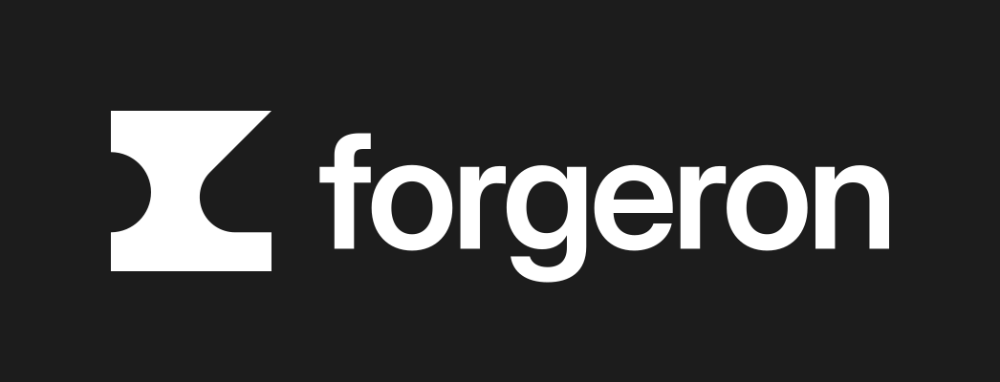

<p align="center">
  
</p>

<p align="center">
  <strong>Forge your internal tools once, use them from Claude, the API, the web and the terminal.</strong>
</p>

<p align="center">
  <a href="docs/white-paper.md">White paper</a> ·
  <a href="docs/sdk.md">SDK</a> ·
  <a href="docs/ARCHITECTURE.md">Architecture</a> ·
  <a href="CONTRIBUTING.md">Contributing</a> ·
  <a href="SECURITY.md">Security</a>
</p>

---

## Forgeron

Forgeron is an open source platform to write, version, host and govern a company's internal tools. A developer describes a tool once with the SDK (its data, its actions, its permissions) and Forgeron exposes it through four interfaces: **MCP** for Claude, **API**, **Web** and **CLI**. Everything runs on Cloudflare Workers.

Status: design. The specification is in [`docs/`](docs/README.md) and the repository layout in [`docs/ARCHITECTURE.md`](docs/ARCHITECTURE.md). The docs are in English.

## Getting started

```bash
proto use
bun install
bun run check
```

The full guide (prerequisites, commit conventions, checks, deployment, versioning) is in [CONTRIBUTING.md](CONTRIBUTING.md).

## Contributing

Contributions go through pull requests to `main`. Read the [contributing guide](CONTRIBUTING.md) and the [code of conduct](CODE_OF_CONDUCT.md) first.

Found a security issue? Do not open a public issue: follow the [security policy](SECURITY.md).

## License

To be decided (see the open questions in the [white paper](docs/white-paper.md#open-questions)).
