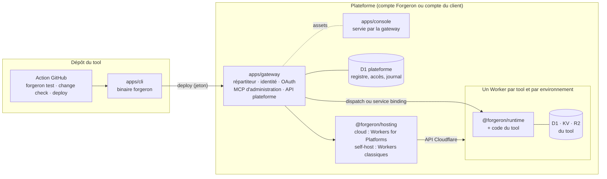
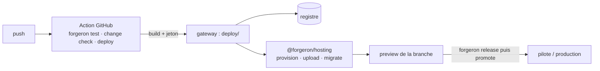
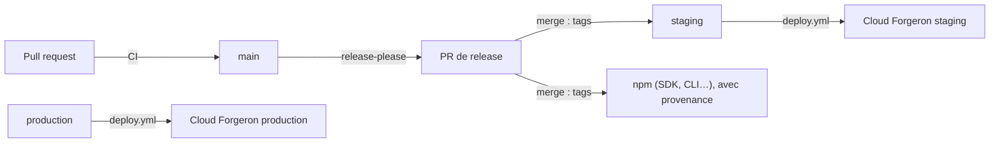

# Architecture du monorepo Forgeron

> Statut : proposition (22 octobre 2026), à valider par l'équipe. Elle découle de [`white-paper.md`](white-paper.md), de [`sdk.md`](sdk.md) et des enseignements du POC Toolbox. Les décisions et leurs raisons sont tenues dans [`DECISIONS.md`](DECISIONS.md) ; ce document en donne le résultat.

Ce document décrit **le dépôt qui construit Forgeron** : le SDK, le CLI, le runtime, la plateforme et les modèles. Il ne décrit pas la forme d'un tool écrit avec Forgeron, qui est l'objet de `sdk.md`.

## Vue d'ensemble



Trois familles de code, trois rythmes :

| Famille                  | Où                                          | Publiée                                             | Exécutée                                                     |
| ------------------------ | ------------------------------------------- | --------------------------------------------------- | ------------------------------------------------------------ |
| Ce qu'importe un tool    | `packages/`                                 | npm (`@forgeron/*`)                                 | neutre (SDK, hosting), Node (compilateur), workerd (runtime) |
| Le CLI                   | `apps/cli`                                  | npm (binaire `forgeron`)                            | Node                                                         |
| La plateforme            | `apps/gateway`, `apps/console`, `apps/site` | déployée (cloud) ; installée par le CLI (self-host) | Cloudflare Workers                                           |
| Les modèles du catalogue | `templates/`                                | npm (`@forgeron/template-*`)                        | comme n'importe quel tool                                    |

## Arborescence

```text
forgeron/
├── apps/
│   ├── cli/                # Binaire `forgeron` : init, dev, play, build, deploy, db, secrets, commandes des tools
│   ├── gateway/            # Worker public : répartition, identité, registre, MCP d'administration, API plateforme
│   ├── console/            # Console de l'espace (React + Vite), servie en assets par la gateway
│   └── site/               # Site vitrine forgeron.app (Astro, îlots React)
├── packages/
│   ├── sdk/                # @forgeron/sdk : defineConfig, action, on, schedule ; sous-chemins db, react, testing
│   ├── runtime/            # @forgeron/runtime : exécute un tool dans son Worker, sert MCP / API / CLI / Web
│   ├── compiler/           # @forgeron/compiler : forgeron build, génération et diff des migrations
│   ├── manifest/           # @forgeron/manifest : schéma du manifeste, diff de versions, impact semver
│   ├── hosting/            # @forgeron/hosting : interface de déploiement, modes cloud, self-host et local
│   ├── ui/                 # @forgeron/ui : composants et tokens du design system
│   ├── connector-<nom>/    # @forgeron/connector-<nom> (plus tard : microsoft-365, odoo…)
│   └── tsconfig/           # @forgeron/tsconfig
├── templates/
│   ├── crm/                # docs/exemples/01-crm.md
│   ├── odoo-gateway/       # docs/exemples/02-passerelle-odoo.md
│   ├── inventaire/         # docs/exemples/03-centre-de-donnees.md
│   └── pilotage/           # docs/exemples/04-tableau-de-bord.md
├── assets/                 # logos, schémas, design system (source des tokens de @forgeron/ui)
├── docs/                   # white paper, spécification du SDK, exemples, décisions, ce document
└── .github/ · .moon/ · …   # outillage (voir « Outillage »)
```

Chaque app, paquet et modèle a son `README.md`, qui dit son rôle, ce qu'il contient et les sections de la spec qu'il met en œuvre.

Les modèles sont dans le dépôt pour une raison précise : ce sont les **tests d'intégration du SDK**. Chaque exemple de `docs/exemples/` devient un modèle qui doit compiler, passer ses tests et se déployer en preview à chaque PR. Si une décision du SDK casse un exemple, la CI le voit.

## Les paquets (`packages/`)

| Paquet                  | Contenu                                                                                                 | Plateforme                              | Dépend de               |
| ----------------------- | ------------------------------------------------------------------------------------------------------- | --------------------------------------- | ----------------------- |
| `@forgeron/sdk`         | `defineConfig`, `action`, `on`, `schedule`, `z`, `ToolError` ; sous-chemins `/db`, `/react`, `/testing` | neutre (SDK), workerd (testing)         | `runtime`, `manifest`   |
| `@forgeron/runtime`     | Routage des quatre interfaces, contrôle d'accès, contexte `ctx`, événements, tâches                     | **workerd uniquement**, aucun `node:*`  | `manifest`              |
| `@forgeron/compiler`    | Découverte des tools, bundle du Worker, manifeste, vues, migrations, empreintes                         | Node                                    | `manifest`              |
| `@forgeron/manifest`    | Schéma Zod du manifeste, comparaison de deux manifestes, impact minimal (`sdk.md` §16)                  | neutre                                  | `zod` seulement         |
| `@forgeron/hosting`     | Interface de déploiement et ses trois modes (voir « Modes d'hébergement »)                              | neutre (appels HTTP à l'API Cloudflare) | `manifest`              |
| `@forgeron/ui`          | Composants React alignés sur `design-system.md`, tokens issus de `assets/design-system/tokens.json`     | navigateur                              | `react` (peer)          |
| `@forgeron/connector-*` | Un client tiers par connecteur                                                                          | workerd                                 | `@forgeron/sdk` (types) |

Points de conception :

- **Le CLI est une app, pas un sous-module du SDK** (D-003). Un tool importe `@forgeron/sdk` ; le binaire `forgeron` dépend du SDK, du compilateur et de `hosting`, jamais l'inverse.
- **`@forgeron/manifest` est la pièce centrale.** Le compilateur l'écrit ; la gateway le lit pour router et contrôler les accès ; `hosting` y lit les ressources à créer ; le CLI en tire ses commandes ; `forgeron change check` compare deux versions. Le figer tôt permet d'avancer en parallèle.
- **Le runtime ignore le mode d'hébergement.** Un tool est un Worker ordinaire qui lit ses ressources dans `env`, en cloud comme en self-host ou en local.
- **`@forgeron/hosting` est neutre** : il parle à l'API Cloudflare par `fetch`, ce qui permet de l'utiliser depuis la gateway (Worker) comme depuis le CLI (Node).
- **Le build s'appuie sur un bundler existant** (Rolldown, déjà sous Vite 8 et tsdown), sans configuration côté développeur.
- Les paquets publiés sont construits avec **tsdown** et vérifiés par **publint**, comme le SDK Odoo. Le point d'entrée neutre du SDK est contrôlé par un script qui refuse tout `node:*` dans le bundle.

## La plateforme (`apps/`)

| App       | Stack                                         | Hébergement                                      | Rôle                                                                                                                                                                    |
| --------- | --------------------------------------------- | ------------------------------------------------ | ----------------------------------------------------------------------------------------------------------------------------------------------------------------------- |
| `cli`     | Node, `@forgeron/sdk`, `compiler`, `hosting`  | publié sur npm, exécuté sur le poste ou en CI    | Cycle de vie d'un tool (`sdk.md` §5), installation de la plateforme en self-host, appel des actions des tools                                                           |
| `gateway` | Hono, `workers-oauth-provider`, Kysely sur D1 | Worker, route `*.<domaine>/*`                    | Répartiteur (espace → tool → environnement), identité (SSO, OAuth 2.1, jetons à audience), registre, journal, MCP d'administration, déploiement des tools via `hosting` |
| `console` | React, Vite, `@forgeron/ui`                   | Assets de la gateway (même origine que l'espace) | Tools, versions, environnements, rôles × actions, secrets, approbation des ressources                                                                                   |
| `site`    | Astro, îlots React                            | Worker + assets statiques                        | Site vitrine, documentation publique à terme                                                                                                                            |

`apps/cli` est la seule app publiée sur npm : elle s'exécute chez le développeur. Elle reste dans `apps/` parce que c'est un exécutable final, que rien n'importe.

La gateway est le seul Worker public de la plateforme. Les Workers des tools n'ont aucune route : seule la gateway les appelle.

### Découpage interne de la gateway

```text
apps/gateway/src/
├── index.ts            # Hono : montage des routes
├── dispatch/           # sous-domaine → espace, /t/<tool>[@branche]/<interface> → Worker du tool
├── identity/           # SSO, sessions, OAuth 2.1 (MCP), jetons à audience espace/tool
├── registry/           # tools, builds, versions, environnements, approbations (D1)
├── deploy/             # réception d'un build, appel de @forgeron/hosting, bascule du trafic
├── admin-mcp/          # outils du MCP d'administration (sdk.md §17)
├── console-api/        # API consommée par apps/console
└── audit/              # journal d'usage et de déploiement
```

Ces dossiers deviendront des paquets seulement si le besoin s'en fait sentir.

## Modes d'hébergement

Décidé le 22/10/2026 (D-009). La même plateforme tourne dans deux contextes ; seule l'implémentation de `@forgeron/hosting` change.

|                    | Cloud Forgeron                                                           | Self-host                                                                                      | Local                                              |
| ------------------ | ------------------------------------------------------------------------ | ---------------------------------------------------------------------------------------------- | -------------------------------------------------- |
| Pour qui           | Les clients qui paient l'hébergement tout inclus                         | Une équipe qui veut tout sur son propre compte Cloudflare                                      | Le développeur d'un tool                           |
| Compte Cloudflare  | celui de Forgeron                                                        | celui du client                                                                                | aucun                                              |
| Un tool, c'est     | un Worker utilisateur dans un dispatch namespace (Workers for Platforms) | un Worker classique, créé par l'API Cloudflare                                                 | un Worker local (workerd) lancé par `forgeron dev` |
| Gateway → tool     | dispatch namespace                                                       | service binding, ajouté en redéployant la gateway par l'API quand un tool est créé ou supprimé | appel direct                                       |
| Ressources du tool | D1, KV, R2 propres, déclarées à l'envoi du code                          | D1, KV, R2 propres, créées par l'API                                                           | D1, KV, R2 locales                                 |
| Plan requis        | Workers Paid + Workers for Platforms (25 $ par mois)                     | Workers Paid                                                                                   | —                                                  |
| Limite notable     | 1 000 scripts inclus, puis 0,02 $ par script                             | 500 Workers par compte                                                                         | —                                                  |

### L'interface `@forgeron/hosting`

Une seule interface, trois implémentations (`cloud`, `self-host`, `local`). Elle couvre :

1. **provision** : créer les ressources demandées par le manifeste (une D1 par environnement, KV, R2) ;
2. **upload** : envoyer le Worker d'un build avec ses bindings ;
3. **migrate** : appliquer les migrations du build à la base de l'environnement ;
4. **activate** : faire servir ce build à un environnement (production, pilote, preview) ;
5. **teardown** : supprimer une preview ou un tool, avec ses ressources.

La gateway appelle cette interface à la réception d'un build ; le CLI l'appelle pour `forgeron dev` (mode `local`) et pour installer la plateforme en self-host.

### Nommage des Workers et des bases

Un nom stable par tool et par environnement, pour que publier une version ne change aucun lien :

```text
<espace>--<tool>--production      <espace>--<tool>--pilot      <espace>--<tool>--pr-<n>
```

En self-host, la gateway n'est redéployée que lorsqu'un tool est créé ou supprimé, jamais à chaque version.

### Installer la plateforme en self-host

Proposition : `forgeron platform install`, depuis le CLI, avec un jeton API Cloudflare limité à Workers, D1, KV et R2. Il crée la D1 de la plateforme, déploie la gateway et la console sur le compte, et range le jeton dans les secrets de la gateway, qui s'en sert ensuite pour déployer les tools. Ce jeton est le secret le plus sensible de l'installation.

## Publication d'un tool

Le build se fait dans la CI du dépôt du tool (D-004, `sdk.md` §15), pas sur la plateforme.



- **Découverte** : chaque `forgeron.config.ts` du dépôt est un tool (D-006) ; l'action les traite tous.
- **Ce que reçoit la gateway** : le contenu de `.forgeron/build/` (Worker, manifeste, migrations, vues, changelog), avec l'empreinte du code.
- **Promotion** : `activate` sur l'environnement visé, sans rebuild.
- **Nettoyage** : `teardown` de la preview quand sa branche est fusionnée ou supprimée. C'est indispensable en self-host (500 Workers par compte).
- **Application GitHub** : plus tard, pour installer l'action et afficher les déploiements dans les PR. Elle ne construit rien.

## Règles de dépendance

Contrôlées par `bun run deps` (dependency-cruiser, `.dependency-cruiser.cjs`) en CI. `bun run deps:selftest` écrit un import fautif par règle et vérifie qu'elle le refuse : une règle qui ne refuserait plus rien, ou un outil qui n'analyserait plus aucun module (voir D-002), fait échouer `bun run check`.

- aucun cycle, aucun import non résolu ;
- un paquet ou un modèle n'importe jamais une app ;
- une app n'importe jamais une autre app : le code partagé passe par `packages/` ;
- un modèle n'utilise que l'API publique (`@forgeron/sdk`, `@forgeron/ui`, connecteurs) ;
- `@forgeron/runtime` n'importe ni `node:*` ni le compilateur (hors types) ;
- `@forgeron/sdk` n'importe ni le compilateur ni `hosting` (`sdk-stays-light`) : un tool n'embarque jamais d'outil de build ou de déploiement ;
- `@forgeron/manifest` ne dépend d'aucun autre paquet du dépôt ;
- `@forgeron/ui` n'importe pas le SDK.

## Outillage

Repris de siages et du SDK Odoo (D-001), pour que tous nos dépôts se ressemblent.

| Outil                 | Rôle                                                      | Fichier                                |
| --------------------- | --------------------------------------------------------- | -------------------------------------- |
| proto                 | Épingle Node, Bun et moon                                 | `.prototools`                          |
| Bun                   | Gestionnaire de paquets, workspaces                       | `package.json`                         |
| moon                  | Tâches par projet (`moon.yml` dans chacun), cache         | `.moon/`                               |
| TypeScript 6          | Typage (`tsc --noEmit` par projet) ; pas la 7, voir D-002 | `packages/tsconfig/base.json`          |
| oxlint · oxfmt        | Lint et formatage                                         | `.oxlintrc.json`, `.oxfmtrc.json`      |
| Vitest                | Tests                                                     | `vitest.config.ts`                     |
| knip                  | Code et dépendances inutilisés                            | `knip.json`                            |
| dependency-cruiser    | Règles d'import et leur auto-test                         | `.dependency-cruiser.cjs`, `scripts/`  |
| lefthook · commitlint | Hooks git, Conventional Commits                           | `lefthook.yml`, `commitlint.config.js` |
| release-please        | Versions, tags, `CHANGELOG.md` du dépôt Forgeron          | `release-please-config.json`           |
| tsdown · publint      | Build et contrôle des paquets publiés                     | à ajouter avec le premier paquet       |
| wrangler              | Dev local et déploiement des apps de la plateforme        | `wrangler.jsonc` par app               |

## Environnements de la plateforme

Ceux de Forgeron lui-même, à ne pas confondre avec les environnements d'un tool (`local`, `preview`, `pilot`, `production`, `sdk.md` §15).

| Environnement | Gateway                                              | Console               | Site                   |
| ------------- | ---------------------------------------------------- | --------------------- | ---------------------- |
| development   | `localhost:8787` (`*.localhost`)                     | `localhost:5174`      | `localhost:5173`       |
| staging       | `*.staging.forgeron.app` à valider (voir ci-dessous) | servie par la gateway | `staging.forgeron.app` |
| production    | `*.forgeron.app`                                     | servie par la gateway | `forgeron.app`         |

Le certificat universel de Cloudflare ne couvre qu'un niveau de sous-domaine : `acme.staging.forgeron.app` n'est pas couvert. Il faut soit un domaine distinct pour staging (par exemple `*.forgeron-staging.app`), soit un certificat avancé. **À trancher avant le premier déploiement.**

En self-host, le domaine est celui du client ; la même règle d'un seul niveau de sous-domaine s'applique.

## Livraison du dépôt Forgeron

### Versions

| Composant release-please | Chemins                                                                  | Tag                     |
| ------------------------ | ------------------------------------------------------------------------ | ----------------------- |
| `sdk` (versions liées)   | `packages/sdk`, `runtime`, `compiler`, `manifest`, `hosting`, `apps/cli` | `sdk-v0.4.0`            |
| `ui`                     | `packages/ui`                                                            | `ui-v0.2.0`             |
| un par connecteur        | `packages/connector-<nom>`                                               | `connector-odoo-v0.1.0` |
| `platform`               | `apps/gateway`, `apps/console`, `apps/site`                              | `platform-v0.3.0`       |

Les modèles (`templates/`) ne passent pas par release-please : ce sont des tools, ils utilisent `forgeron release` (D-007) et leurs tags sont `crm@1.0.0`.

Tant qu'aucun paquet n'est publié, la configuration reste celle de siages : une seule version pour tout le dépôt (`packages: { ".": {} }`). On passe au mode multi-composants (plugin `linked-versions` pour le groupe `sdk` : le CLI et le SDK d'une même version se comprennent toujours) avec la première publication npm.

La version suit les commits : `fix` → patch, `feat` → minor, `feat!` ou `BREAKING CHANGE` → major (minor tant qu'on est en `0.x`).

### Chaîne



1. Chaque PR vers `main` passe la CI : lint, format, types, tests, knip, deps, titre de PR.
2. Le merge de la PR de release crée les tags, avance `staging` et y déploie la plateforme cloud.
3. La publication npm (à ajouter) part du même événement, en _trusted publishing_ depuis GitHub Actions. Les clients self-host installent la plateforme à partir de ces paquets, avec `forgeron platform install`.
4. La production cloud se déploie en poussant la branche `production`.

## Ordre de construction proposé

1. **Socle** (fait) : outillage, CI, conventions, versioning, squelette des apps et paquets.
2. **`@forgeron/manifest`** : schéma et diff, entièrement testables sans Cloudflare.
3. **SDK + runtime + `forgeron dev`** (mode `local` de `hosting`) sur un tool sans base : le modèle `odoo-gateway`. Sortie : un MCP local qui fonctionne.
4. **Base et migrations** (`@forgeron/sdk/db`, générateur) avec le modèle `crm`.
5. **Gateway + `hosting` self-host** : identité, registre, déploiement en preview sur un compte Cloudflare classique.
6. **`hosting` cloud** (Workers for Platforms), console, puis connecteurs et modèles suivants.

Le self-host passe avant le cloud : il se teste sur un compte Workers Paid ordinaire, sans acheter Workers for Platforms.

## Décisions ouvertes

Les décisions prises sont dans [`DECISIONS.md`](DECISIONS.md). Restent ouvertes :

| Décision                                                                   | Bloque                       | État connu                                                                                                         |
| -------------------------------------------------------------------------- | ---------------------------- | ------------------------------------------------------------------------------------------------------------------ |
| Transaction par action (`sdk.md` §6, §9) avec D1                           | étape 4                      | D1 ne semble proposer que des lots atomiques, sans transaction interactive (à vérifier) ; piste : `ctx.db.batch()` |
| Previews en self-host sans redéployer la gateway à chaque branche          | étape 5                      | pistes : URL de preview par version (à vérifier), accès HTTP avec jeton interne                                    |
| Envoi d'un Worker utilisateur avec sa D1 sur Workers for Platforms         | étape 6                      | documenté (doc du 16/09/2026), non essayé ; achat de Workers for Platforms requis                                  |
| Ressources OAuth dynamiques (un jeton par tool sans redéployer la gateway) | étape 5                      | point le plus risqué selon le POC Toolbox : la bibliothèque fixe les ressources à la construction                  |
| Domaine de staging (certificat sur deux niveaux)                           | premier déploiement          | voir « Environnements »                                                                                            |
| Licence open source                                                        | publication npm, `LICENSE`   | absent du dépôt tant que ce n'est pas tranché                                                                      |
| Organisation GitHub et nom de dépôt                                        | badges, liens, `SECURITY.md` | `OWNER/forgeron` en attendant                                                                                      |
| Nom npm public : `forgeron` ou `@forgeron/sdk` + `@forgeron/cli`           | publication, `sdk.md` §18    | piste : publier le CLI sous `forgeron` pour garder `npx forgeron`                                                  |
| Langue des fichiers du dépôt (README, CONTRIBUTING)                        | —                            | français, comme la doc existante ; siages est en anglais                                                           |
