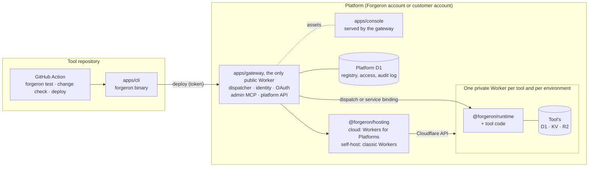
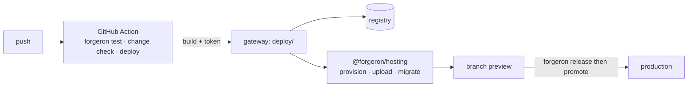
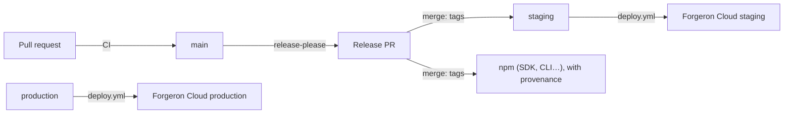

# Forgeron monorepo architecture

> Status: proposal (October 22, 2026), to be validated by the team. It derives from [`white-paper.md`](white-paper.md), [`sdk.md`](sdk.md) and the lessons of the Toolbox POC. Decisions and their rationale are kept in [`DECISIONS.md`](DECISIONS.md); this document gives the outcome.

This document describes **the repository that builds Forgeron**: the SDK, the CLI, the runtime, the platform and the templates. It does not describe the shape of a tool written with Forgeron, which is the subject of `sdk.md`.

## Overview



Three families of code, three rhythms:

| Family              | Where                                       | Published                                          | Runs on                                                    |
| ------------------- | ------------------------------------------- | -------------------------------------------------- | ---------------------------------------------------------- |
| What a tool imports | `packages/`                                 | npm (`@forgeron/*`)                                | neutral (SDK, hosting), Node (compiler), workerd (runtime) |
| The CLI             | `apps/cli`                                  | npm (`forgeron` binary)                            | Node                                                       |
| The platform        | `apps/gateway`, `apps/console`, `apps/site` | deployed (cloud); installed by the CLI (self-host) | Cloudflare Workers                                         |
| Catalog templates   | `templates/`                                | npm (`@forgeron/template-*`)                       | like any other tool                                        |

## Directory tree

```text
forgeron/
├── apps/
│   ├── cli/                # `forgeron` binary: init, dev, play, build, deploy, db, secrets, tool commands
│   ├── gateway/            # Public Worker: dispatch, identity, registry, admin MCP, platform API
│   ├── console/            # Workspace console (React + Vite), served as assets by the gateway
│   └── site/               # forgeron.app marketing site (Astro, React islands)
├── packages/
│   ├── sdk/                # @forgeron/sdk: defineConfig, action, on, schedule; subpaths db, react, testing
│   ├── runtime/            # @forgeron/runtime: runs a tool in its Worker, serves MCP / API / CLI / Web
│   ├── compiler/           # @forgeron/compiler: forgeron build, migration generation and diff
│   ├── manifest/           # @forgeron/manifest: manifest schema, version diff, semver impact
│   ├── platform-contract/  # @forgeron/platform-contract: the platform API as route objects (zod), error body, typed client
│   ├── hosting/            # @forgeron/hosting: deployment interface, cloud, self-host and local modes
│   ├── registry/           # @forgeron/registry: platform D1 schema (migrations) and typed access layer
│   ├── playground/         # @forgeron/playground: the playground page, for `forgeron play` and /t/<tool>/play
│   ├── ui/                 # @forgeron/ui: design system components and tokens
│   ├── connector-google-workspace/  # @forgeron/connector-google-workspace
│   ├── connector-microsoft-365/ # @forgeron/connector-microsoft-365: Microsoft Graph connector
│   ├── connector-<name>/   # @forgeron/connector-<name> (later: slack, github…)
│   └── tsconfig/           # @forgeron/tsconfig
├── templates/
│   ├── crm/                # docs/examples/01-crm.md
│   ├── odoo-gateway/       # docs/examples/02-odoo-gateway.md
│   ├── inventory/          # docs/examples/03-data-hub.md
│   └── dashboard/          # docs/examples/04-dashboard.md
├── assets/                 # logos, previews, design system (source of the @forgeron/ui tokens)
├── docs/                   # white paper, SDK specification, examples, decisions, this document
└── .github/ · .moon/ · …   # tooling (see "Tooling")
```

Each app, package and template has its own `README.md`, which states its role, what it contains and the spec sections it implements.

Templates live in the repository for a specific reason: they are the **SDK's integration tests**. Each example in `docs/examples/` becomes a template that must compile, pass its tests and deploy as a preview on every PR. If an SDK decision breaks an example, CI catches it. `bun run test` builds and tests every template; `.github/workflows/templates-preview.yml` tests, checks and deploys each one as a preview with the deploy action (one `FORGERON_TOKEN_<NAME>` secret per template, since a deployment token is bound to one tool), comments the preview address on the pull request and tears the previews down when it is closed (D-045); `bun run templates:check` refuses a template that is not in that workflow.

## Packages (`packages/`)

| Package                       | Contents                                                                                                                                                             | Platform                                   | Depends on              |
| ----------------------------- | -------------------------------------------------------------------------------------------------------------------------------------------------------------------- | ------------------------------------------ | ----------------------- |
| `@forgeron/sdk`               | `defineConfig`, `action`, `on`, `schedule`, `z`, `ToolError`; subpaths `/db`, `/react`, `/testing`                                                                   | neutral (SDK), workerd (testing)           | `runtime`, `manifest`   |
| `@forgeron/runtime`           | Routing of the four interfaces, access control, `ctx` context, events, jobs                                                                                          | **workerd only**, no `node:*`              | `manifest`              |
| `@forgeron/compiler`          | Tool discovery, Worker bundle, manifest, views, migrations, fingerprints                                                                                             | Node                                       | `manifest`              |
| `@forgeron/manifest`          | Zod manifest schema, comparison of two manifests, minimum impact (`sdk.md` §16)                                                                                      | neutral                                    | `zod` only              |
| `@forgeron/platform-contract` | Route objects of the platform API (`defineRoute`), `ErrorSchema`, `createClient` (typed `fetch` client); read by the gateway, the console and the CLI (D-064, D-075) | neutral, no HTTP library                   | `zod`, `manifest`       |
| `@forgeron/hosting`           | Deployment interface and its three modes (see "Hosting modes")                                                                                                       | neutral (HTTP calls to the Cloudflare API) | `manifest`              |
| `@forgeron/registry`          | Platform D1: schema migrations and typed access (tools, builds, versions, environments, approvals, encrypted secrets)                                                | neutral                                    | `hosting`               |
| `@forgeron/playground`        | The playground page (actions, generated forms, what MCP, API and CLI see), served by `forgeron play` and at `/t/<tool>/play`                                         | neutral                                    | none                    |
| `@forgeron/ui`                | React components aligned with `design-system.md`, tokens from `assets/design-system/tokens.json`                                                                     | browser                                    | `react` (peer)          |
| `@forgeron/connector-*`       | One third-party client per connector                                                                                                                                 | workerd                                    | `@forgeron/sdk` (types) |

Design points:

- **The CLI is an app, not a submodule of the SDK** (D-003). A tool imports `@forgeron/sdk`; the `forgeron` binary depends on the SDK, the compiler and `hosting`, never the other way around.
- **`@forgeron/manifest` is the central piece.** The compiler writes it; the gateway reads it to route and check access; `hosting` reads the resources to create from it; the CLI derives its commands from it; `forgeron change check` compares two versions. Freezing it early allows work to proceed in parallel.
- **The runtime is unaware of the hosting mode.** A tool is an ordinary Worker that reads its resources from `env`, in cloud, self-host or local mode alike.
- **`@forgeron/hosting` is neutral**: it talks to the Cloudflare API through `fetch`, so it can be used from the gateway (a Worker) as well as from the CLI (Node).
- **The build relies on an existing bundler** (Rolldown, already under Vite 8 and tsdown), with no configuration on the developer's side.
- Published packages are built with **tsdown** and checked with **publint**, like the Odoo SDK. The SDK's neutral entry point is checked by a script that rejects any `node:*` in the bundle.

## The platform (`apps/`)

| App       | Stack                                        | Hosting                                         | Role                                                                                                                                                              |
| --------- | -------------------------------------------- | ----------------------------------------------- | ----------------------------------------------------------------------------------------------------------------------------------------------------------------- |
| `cli`     | Node, `@forgeron/sdk`, `compiler`, `hosting` | published on npm, run on a workstation or in CI | Tool lifecycle (`sdk.md` §5), platform installation in self-host, calling tool actions                                                                            |
| `gateway` | Hono, `workers-oauth-provider`, Kysely on D1 | Worker, route `*.<domain>/*`                    | Dispatcher (workspace → tool → environment), identity (SSO, OAuth 2.1, audience-scoped tokens), registry, audit log, admin MCP, tool deployment through `hosting` |
| `console` | React, Vite, `@forgeron/ui`                  | Gateway assets (same origin as the workspace)   | Shell, first-run checklist, tools, members and invitations, roles × actions, secrets, resource approval, audit log, settings                                      |
| `site`    | Astro, React islands                         | Worker + static assets                          | Marketing site, public documentation eventually                                                                                                                   |

`apps/cli` is the only app published on npm: it runs on the developer's machine. It stays in `apps/` because it is a final executable that nothing imports.

The gateway is the only public Worker of the platform. Tool Workers have no route: only the gateway calls them.

### Internal layout of the gateway

```text
apps/gateway/src/
├── index.ts            # Hono: route mounting
├── dispatch/           # subdomain → workspace, /t/<tool>[@branch]/<interface> → tool Worker
├── identity/           # authn/ (session, tokens, caller), sign-in/ (OIDC, SAML, email), cli-login/
├── integration/        # the tests that drive the whole gateway through `createGateway`
├── registry/           # uses @forgeron/registry: tools, builds, versions, environments, approvals (D1)
├── deploy/             # receiving a build, calling @forgeron/hosting, traffic switch
├── admin-mcp/          # admin MCP tools (sdk.md §17)
├── console-api/        # API consumed by apps/console
└── audit/              # usage and deployment audit log
```

These folders will become packages only if the need arises.

## The platform API

One Hono app (`createPlatform`, `apps/gateway/src/platform`) answers every route of the platform API: the console's under `/console-api` and the CLI's at the root of the workspace (`/whoami`, `/deploy`, `/promote`, `/rollback`, `/deploy-tokens`, `/auth/token`…). A path it does not own gets the gateway's 404. The hand-written pages (`/auth/login`, `/auth/cli`, the sign-in forms), the tools under `/t/` and the personal secrets page are not routes of the API and stay outside it.

- **Where the contract lives**: `packages/platform-contract/src`, one module per area (`members.ts`, `bearer.ts`…). A route is plain data (`defineRoute`: method, path, request and answers as zod schemas); the package has no HTTP library. The gateway serves it, the console and the CLI call it through `createClient` (`@forgeron/platform-contract/client`), which imports no schema.
- **The OpenAPI document**: `GET /console-api/api/openapi.json`, for a signed-in member, describes the routes under `/console-api` (D-066).
- **Adding a route**:
  1. Write the route object in its module in `packages/platform-contract/src` and export it from `index.ts`.
  2. Give it an entry in `addresses.ts` (`addressOf<typeof route>({ method, path })`): a test fails until every route has one, with its own method and path.
  3. Mount it in `apps/gateway/src/platform/<area>.ts` with `app.openapi(platformRoute(route, "member" | "developer" | "admin"), handler)`, and call `mount…` from `platform.ts`. The guards (401, 403, the Origin check on writes, JSON only) come with `platformRoute`.
  4. Test it with `describeRouteMatrix` (`route-matrix.ts`): 401, 403, 415, 400 and the Origin cases for free.
  5. Call it from the console with `ok(await typedClient(fetchJson)(addresses.x, input))`, from the CLI with `platformClient(endpoint, token)`.
- A route whose checks must keep their own order or words (the database explorer, the CLI's routes, consent) is registered in the contract and answered by its handler (`app.all`), as D-070, D-075 and D-076 say.

## Hosting modes

Decided on 22/10/2026 (D-009). The same platform runs in two contexts; only the implementation of `@forgeron/hosting` changes.

|                    | Forgeron Cloud                                                | Self-host                                                                                           | Local                                              |
| ------------------ | ------------------------------------------------------------- | --------------------------------------------------------------------------------------------------- | -------------------------------------------------- |
| Who it is for      | Customers who pay for all-inclusive hosting                   | A team that wants everything on its own Cloudflare account                                          | The tool developer                                 |
| Cloudflare account | Forgeron's                                                    | the customer's                                                                                      | none                                               |
| A tool is          | a user Worker in a dispatch namespace (Workers for Platforms) | a classic Worker, created through the Cloudflare API                                                | a local Worker (workerd) started by `forgeron dev` |
| Gateway → tool     | dispatch namespace                                            | service binding, added by redeploying the gateway through the API when a tool is created or deleted | direct call                                        |
| Tool resources     | Dedicated D1, KV, R2, declared when the code is uploaded      | Dedicated D1, KV, R2, created through the API                                                       | local D1, KV, R2                                   |
| Required plan      | Workers Paid + Workers for Platforms ($25 per month)          | Workers Paid                                                                                        | —                                                  |
| Notable limit      | 1,000 scripts included, then $0.02 per script                 | 500 Workers per account                                                                             | —                                                  |

### The `@forgeron/hosting` interface

A single interface, three implementations (`cloud`, `self-host`, `local`). It covers:

1. **provision**: create the resources requested by the manifest (one D1 per environment, KV, R2);
2. **upload**: send a build's Worker with its bindings;
3. **migrate**: apply the build's migrations to the environment's database;
4. **activate**: make an environment (production, preview) serve this build;
5. **teardown**: delete a preview or a tool, along with its resources.

The gateway calls this interface when it receives a build; the CLI calls it for `forgeron dev` (`local` mode) and to install the platform in self-host.

### Naming of Workers and databases

One stable name per tool and per environment, so that publishing a version changes no link:

```text
<workspace>--<tool>--production      <workspace>--<tool>--pr-<n>
```

In self-host, the gateway is redeployed only when a tool is created or deleted, never on every version.

### Installing the platform in self-host

`forgeron platform install` (CLI, step-by-step guide in [`self-host.md`](self-host.md)) takes a Cloudflare API token limited to Workers, D1, KV and R2 from `CLOUDFLARE_API_TOKEN`. It creates the platform D1 and migrates it, deploys the gateway Worker to the account and stores the token as the gateway's secret binding, never printing it. With `--console <dir>` (the build of `apps/console`) it uploads the console as the gateway's static assets. This token is the most sensitive secret of the installation. With `--auth wrangler` the installation instead calls Cloudflare with the token of the wrangler session (`wrangler auth token`); that short-lived token is never stored, so the gateway's secret binding is set from `GATEWAY_CLOUDFLARE_API_TOKEN` or skipped (D-026). `--auth oauth` is reserved and refused. Providers live in `apps/cli/src/commands/cloudflare-auth.ts`.

## Publishing a tool

The build happens in the CI of the tool's repository (D-004, `sdk.md` §15), not on the platform.



- **Discovery**: each `forgeron.config.ts` in the repository is a tool (D-006); the action processes them all.
- **What the gateway receives**: the contents of `.forgeron/build/` (Worker, manifest, migrations, views, changelog), with the code fingerprint.
- **Promotion**: `activate` on the target environment, without a rebuild.
- **Cleanup**: `teardown` of the preview when its branch is merged or deleted. This is essential in self-host (500 Workers per account).
- **GitHub app**: later, to install the action and show deployments in PRs. It builds nothing.

## Dependency rules

Checked by `bun run deps` (dependency-cruiser, `.dependency-cruiser.cjs`) in CI. `bun run deps:selftest` writes one faulty import per rule and checks that the rule rejects it: a rule that no longer rejects anything, or a tool that no longer analyzes any module (see D-002), makes `bun run check` fail.

- no cycles, no unresolved imports;
- a package or a template never imports an app;
- an app never imports another app: shared code goes through `packages/`;
- a template only uses the public API (`@forgeron/sdk`, `@forgeron/ui`, connectors);
- `@forgeron/runtime` imports no `node:*` (`runtime-stays-on-workers`) and no compiler, types aside (`runtime-does-not-import-compiler`);
- `@forgeron/sdk` imports neither the compiler nor `hosting` (`sdk-stays-light`): a tool never ships a build or deployment tool;
- `@forgeron/manifest` depends on no other package of the repository;
- `@forgeron/ui` does not import the SDK;
- the registry has one door, `@forgeron/registry` (`registry-door-is-index`): nothing outside the package imports a file under `packages/registry/src/` other than `index.ts`;
- inside the registry, a module (`modules/<domain>/`) is imported through its `public.ts` only, by another module (`module-uses-public-api`) and by the rest of the package (`registry-root-uses-module-public-api`); the registry's `kernel/` imports no module (`kernel-is-generic`);
- the gateway's `kernel/` (`Person`, `workspaceOf`) imports nothing else of the gateway (`gateway-kernel-is-a-leaf`); `dispatch/` and `pages/` never import `identity/` and `identity/` never imports `dispatch/` (`identity-is-below-dispatch-and-pages`, `identity-does-not-import-dispatch`): folder cycles that the file-level `no-cycles` cannot see;
- the gateway wires its areas in `compose.ts` (`createModules` once, `createRequestModules` per request) and `gateway.ts` is the table of routes; an area takes the narrow port it uses (`Pick<Registry, …>`) and never imports `compose.ts` (`gateway-compose-is-the-root`);
- inside `identity/`, `authn/` imports neither `sign-in/` nor `cli-login/` (`identity-authn-is-a-leaf`) and those two do not import each other (`identity-sign-in-and-cli-login-are-apart`).
- `@forgeron/platform-contract` imports no package of the repository but `manifest` (`platform-contract-imports-schemas-only`); its only npm dependency is `zod`, which knip enforces (an import that `package.json` does not list fails).

## Tooling

Taken from siages and the Odoo SDK (D-001), so that all our repositories look alike.

| Tool                  | Role                                                      | File                                   |
| --------------------- | --------------------------------------------------------- | -------------------------------------- |
| proto                 | Pins Node, Bun and moon                                   | `.prototools`                          |
| Bun                   | Package manager, workspaces                               | `package.json`                         |
| moon                  | Per-project tasks (`moon.yml` in each), cache             | `.moon/`                               |
| TypeScript 6          | Typing (`tsc --noEmit` per project); not 7, see D-002     | `packages/tsconfig/base.json`          |
| oxlint · oxfmt        | Lint and formatting                                       | `.oxlintrc.json`, `.oxfmtrc.json`      |
| Vitest                | Tests                                                     | `vitest.config.ts`                     |
| knip                  | Unused code and dependencies                              | `knip.json`                            |
| dependency-cruiser    | Import rules and their self-test                          | `.dependency-cruiser.cjs`, `scripts/`  |
| lefthook · commitlint | Git hooks, Conventional Commits                           | `lefthook.yml`, `commitlint.config.js` |
| release-please        | Versions, tags, `CHANGELOG.md` of the Forgeron repository | `release-please-config.json`           |
| tsdown · publint      | Build and checks of published packages                    | to be added with the first package     |
| wrangler              | Local dev and deployment of the platform apps             | `wrangler.jsonc` per app               |

## Platform environments

Those of Forgeron itself, not to be confused with a tool's environments (`local`, `preview`, `production`, `sdk.md` §15).

| Environment | Gateway                                              | Console               | Site                   |
| ----------- | ---------------------------------------------------- | --------------------- | ---------------------- |
| development | `localhost:8787` (`*.localhost`)                     | `localhost:5174`      | `localhost:5173`       |
| staging     | `*.staging.forgeron.app` to be validated (see below) | served by the gateway | `staging.forgeron.app` |
| production  | `*.forgeron.app`                                     | served by the gateway | `forgeron.app`         |

Cloudflare's universal certificate covers only one level of subdomain: `acme.staging.forgeron.app` is not covered. Either a separate domain is needed for staging (for example `*.forgeron-staging.app`), or an advanced certificate. **To be decided before the first deployment.**

In self-host, the domain is the customer's; the same single-subdomain-level rule applies.

## Delivering the Forgeron repository

### Versions

| release-please component | Paths                                                                    | Tag                     |
| ------------------------ | ------------------------------------------------------------------------ | ----------------------- |
| `sdk` (linked versions)  | `packages/sdk`, `runtime`, `compiler`, `manifest`, `hosting`, `apps/cli` | `sdk-v0.4.0`            |
| `ui`                     | `packages/ui`                                                            | `ui-v0.2.0`             |
| one per connector        | `packages/connector-<name>`                                              | `connector-odoo-v0.1.0` |
| `platform`               | `apps/gateway`, `apps/console`, `apps/site`                              | `platform-v0.3.0`       |

Templates (`templates/`) do not go through release-please: they are tools, they use `forgeron release` (D-007) and their tags look like `crm@1.0.0`.

As long as no package is published, the configuration stays that of siages: a single version for the whole repository (`packages: { ".": {} }`). We switch to multi-component mode (`linked-versions` plugin for the `sdk` group: a CLI and an SDK of the same version always understand each other) with the first npm publication.

The version follows the commits: `fix` → patch, `feat` → minor, `feat!` or `BREAKING CHANGE` → major (minor while in `0.x`).

### Pipeline



1. Every PR to `main` goes through CI: lint, format, types, tests, knip, deps, PR title.
2. Merging the release PR creates the tags, advances `staging` and deploys the cloud platform there.
3. npm publishing (to be added) starts from the same event, as _trusted publishing_ from GitHub Actions. Self-host customers install the platform from these packages, with `forgeron platform install`.
4. Cloud production is deployed by pushing the `production` branch.

## Proposed build order

1. **Foundation** (done): tooling, CI, conventions, versioning, skeleton of the apps and packages.
2. **`@forgeron/manifest`**: schema and diff, fully testable without Cloudflare.
3. **SDK + runtime + `forgeron dev`** (`local` mode of `hosting`) on a tool without a database: the `odoo-gateway` template. Output: a working local MCP.
4. **Database and migrations** (`@forgeron/sdk/db`, generator) with the `crm` template.
5. **Gateway + self-host `hosting`**: dispatch, identity (company SSO through OIDC, sessions, audience tokens), registry, preview deployment on a regular Cloudflare account. **Gate 1** (Odoo gateway in internal production) needs this step.
6. **Platform**: console, environments and promotion, per-action access by role, per-person secrets, usage log (gate 2: first pilot customer).
7. **Catalog and connectors**: templates, Microsoft 365, Google Workspace, Odoo (gate 3: public launch).
8. **Cloud `hosting`** (Workers for Platforms), React views, subscription and support.

Self-host comes before cloud: it can be tested on an ordinary Workers Paid account, without buying Workers for Platforms.

The white paper's roadmap groups these steps into four phases: phase 1 is steps 1 to 5, phase 2 is step 6, phase 3 is step 7, phase 4 is step 8. The Linear projects follow the same order.

## Open decisions

Decisions already made are in [`DECISIONS.md`](DECISIONS.md). Still open:

| Decision                                                                     | Blocks                       | Known state                                                                                                                        |
| ---------------------------------------------------------------------------- | ---------------------------- | ---------------------------------------------------------------------------------------------------------------------------------- |
| Per-action transaction (`sdk.md` §6, §9) with D1                             | step 4                       | decided, D-012: one atomic `ctx.db.batch()`; no interactive transaction. To do: `sync` handlers joining the batch, remote D1 check |
| Self-host previews without redeploying the gateway for each branch           | step 5                       | leads: per-version preview URL (to be verified), HTTP access with an internal token                                                |
| Uploading a user Worker with its D1 on Workers for Platforms                 | step 8                       | documented (doc of 16/09/2026), not tried; purchase of Workers for Platforms required                                              |
| Dynamic OAuth resources (one token per tool without redeploying the gateway) | step 5                       | decided, D-013: build the authorization server from the registry, cached by registry version; watch the cost above ~100 tools      |
| Staging domain (two-level certificate)                                       | first deployment             | see "Platform environments"                                                                                                        |
| Open source license                                                          | npm publishing, `LICENSE`    | absent from the repository until decided                                                                                           |
| GitHub organization and repository name                                      | badges, links, `SECURITY.md` | `OWNER/forgeron` in the meantime                                                                                                   |
| Public npm name: `forgeron` or `@forgeron/sdk` + `@forgeron/cli`             | publishing, `sdk.md` §18     | lead: publish the CLI as `forgeron` to keep `npx forgeron`                                                                         |

Decided in this change: repository files (README, CONTRIBUTING, docs) are written in English (D-011).
