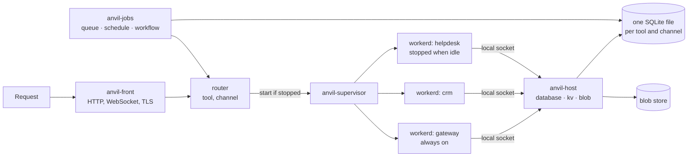

# Target — the runtime (Anvil)

> Status: decided (21 November 2026), to be recorded in `DECISIONS.md`. The choice of what executes TypeScript (decision D5 of [`../reframing.md`](../reframing.md)) was validated by the owner the same day. It rests on three studies made the same day: [`runtime-workerd.md`](../spikes/runtime-workerd.md), [`runtime-deno-bun.md`](../spikes/runtime-deno-bun.md) and [`runtime-landscape.md`](../spikes/runtime-landscape.md). Figures below are theirs, measured on one Apple M4 laptop; nothing was measured on Linux or under load.

Anvil is one Rust binary that runs a Forgeron workspace without Cloudflare: `anvil dev` on a laptop, `anvil serve` on a server the customer runs. It runs the same tool bundles as Cloudflare does, unchanged.

## 1. The decision

**Anvil supervises `workerd`, one process per tool, started on demand and stopped when idle. Anvil's own Rust services hold the data.**

- `workerd` is the runtime Cloudflare runs in production, open source under Apache-2.0. The same bundle on both targets is then a property of the design, not something we test into existence.
- One process per tool gives what a shared process cannot: a tool that loops or allocates without end is killed alone.
- Starting in about 15 ms is what makes "stopped when idle" possible. An unused tool costs no memory, which is the serverless behaviour asked for.
- The data lives in files Anvil owns, because on a customer's server backups and restore are the product.

## 2. What was compared

| Candidate                       | Start to first response | Idle memory per tool       | Isolation between tools                 | Same bundle as Cloudflare      | State                                                 |
| ------------------------------- | ----------------------- | -------------------------- | --------------------------------------- | ------------------------------ | ----------------------------------------------------- |
| `workerd`, one process per tool | 14 ms                   | 33 MB, zero when stopped   | the operating system's process boundary | yes, it is the real runtime    | daily releases, Apache-2.0                            |
| `workerd`, one shared process   | 14 ms, plus compile     | 3–10 MB per tool once warm | none: one loop froze every tool         | yes                            | same                                                  |
| Bun, one process per tool       | 14–26 ms                | 9–16 MB                    | none of its own; needs an OS sandbox    | through an adapter we maintain | active                                                |
| Deno, one process per tool      | 27–35 ms                | 19–28 MB                   | permission flags per process            | through an adapter we maintain | **ending**: a year of fixes, then no development      |
| `celld`                         | not measured            | about 4 MB claimed         | none claimed for hostile code           | yes, from a `wrangler.json`    | beta, one application per fleet, pull requests closed |
| Our own V8 embedding            | —                       | —                          | ours to build                           | ours to build, forever         | —                                                     |

Why not the others:

- **Deno.** On 9 October 2026 its team announced it is joining Cloudflare: monthly fixes for a year, then the end of the runtime's development. Its Rust embedding crate's repository is archived. It had the best isolation of the alternatives and is not a base to build on.
- **Bun.** The lightest and fastest. It has no sandbox, no working memory cap, and cannot be embedded. Above all it is not the Workers runtime: every difference in behaviour between it and Cloudflare is ours to find and paper over, in an adapter of several hundred lines that grows with each API a tool uses. Kept as the fallback of section 7.
- **A shared `workerd` process.** The densest option, and the spike broke it three ways: one infinite loop froze every tool and the process then ignored a termination signal; a CPU limit was accepted and not enforced; one runaway allocation killed the process.
- **`celld`.** Made by the Deno team, it runs Workers, Durable Objects, D1, KV, R2, queues and workflows from an existing Wrangler configuration, which is close to Anvil's purpose. Today it runs one application per fleet, needs an object storage bucket, does not terminate TLS, and takes no outside contributions. Watched, not adopted (section 7).
- **Our own embedding.** `celld` is the measure of its cost: a large Rust codebase by two engineers who wrote Deno's core, still in beta.

## 3. Architecture

| Part               | Does                                                                                                                                   |
| ------------------ | -------------------------------------------------------------------------------------------------------------------------------------- |
| `anvil-front`      | accepts connections, terminates TLS in `serve`, holds WebSockets                                                                       |
| router             | maps a request to a tool and a channel; if the tool's process is stopped, asks the supervisor for it and holds the request meanwhile   |
| `anvil-supervisor` | owns a pinned `workerd`; writes one configuration per tool; starts, watches, stops and kills processes; applies memory and time limits |
| `anvil-host`       | the data contracts, over a local socket                                                                                                |
| `anvil-jobs`       | the time contracts: it delivers queue messages, fires schedules and drives workflows by calling the tool like any request              |

The gateway is a tool like the others for the supervisor, except that it is never stopped.

### Lifecycle of a tool's process

1. **Stopped.** Nothing runs. The tool's bundle and database are on disk.
2. **Starting.** A request, a queue message or a schedule arrives. The supervisor spawns `workerd` with the tool's configuration. Measured: 14 ms for the process, and about 50 ms more to compile a 1.6 MB bundle.
3. **Running.** The router forwards requests. The supervisor samples memory and checks that the process answers.
4. **Idle.** No request for a set time (short in `dev`, minutes in `serve`): the process is stopped. Open WebSockets keep it alive.
5. **Killed.** Memory above its cap, or no answer within the watchdog's delay: `SIGKILL`, since the spike showed a frozen `workerd` ignores `SIGTERM`. The event is logged and counted against the tool.

A new version of a tool is a new configuration and a new process; the old one finishes its requests and is stopped. No other tool is touched. The Worker Loader, which is experimental and did not unload, is not needed.

## 4. How a tool reaches its resources

A tool never knows it is on Anvil. Its bundle sees the same `env` as on Cloudflare, built by `@forgeron/provider-anvil` from the tool's manifest.

| Contract   | On Anvil                                                                                                                      | Why this way                                                                   |
| ---------- | ----------------------------------------------------------------------------------------------------------------------------- | ------------------------------------------------------------------------------ |
| `database` | `workerd`'s own D1 client, pointed at `anvil-host`, which speaks D1's protocol over SQLite. Tool code gets the real `env.DB`. | spike: batch rollback, `raw()` and D1's errors all behaved; 70–80 µs per query |
| `kv`       | a table in SQLite, served by `anvil-host`                                                                                     | one storage engine to back up                                                  |
| `blob`     | files on disk, or an S3-compatible bucket, served by `anvil-host`                                                             | the customer chooses where large files go                                      |
| `secret`   | handed to the process at start, from the engine's sealed store                                                                | never on disk in clear                                                         |
| `queue`    | a journal table; `anvil-jobs` delivers batches to the tool and records acks, retries and dead letters                         | survives a restart; visible to the admin                                       |
| `schedule` | `anvil-jobs` fires `scheduled` at the minute                                                                                  | no per-tool timer process                                                      |
| `workflow` | a journal keyed by instance and step, driven by `anvil-jobs`                                                                  | later wave                                                                     |
| `realtime` | `workerd`'s Durable Objects with WebSocket hibernation, state in a local directory                                            | spike: alarms and hibernation worked and survived a restart                    |

`workerd` has built-in local versions of D1, KV, queues and cron. They are not used for data, for two reasons: they sit behind an `--experimental` flag, and their files would be `workerd`'s to manage, not ours to back up and restore.

## 5. Two profiles, one code path

|           | `anvil dev`                                       | `anvil serve`                                              |
| --------- | ------------------------------------------------- | ---------------------------------------------------------- |
| Data      | a folder in the repository's `.forgeron/`         | a data directory; WAL shipped to object storage, snapshots |
| Entry     | `localhost`, plain HTTP                           | TLS with automatic certificates                            |
| Idle stop | seconds, so restarts are exercised constantly     | minutes                                                    |
| Rebuild   | watches the repository, restarts the changed tool | none; takes builds from the engine                         |
| Chaos     | on request: redelivery, delayed KV reads          | off                                                        |
| Updates   | follows the CLI's version                         | `anvil update`, with the previous version kept             |

Everything else is the same binary on the same paths, so the conformance suite run in `dev` says something about `serve`.

## 6. Costs and limits, stated

- **Size.** `workerd` is 146 MB on macOS arm64 and 156 MB on Linux x64. Anvil downloads the pinned version on first run and checks it against a hash we publish, since `workerd`'s releases carry no checksum file.
- **Version churn.** A release almost daily. One `workerd` version per Anvil release, moved only when the conformance suite passes.
- **Linux floor.** `workerd`'s binaries need glibc 2.35 or newer. Not verified on Linux at all in the spikes.
- **Memory.** 33 MB for a running tool, against 9–16 MB for Bun. Stopping idle tools is what pays for it; a workspace with many tools busy at once needs the memory.
- **Not a sandbox.** `workerd`'s README says it "is not a hardened sandbox". A process per tool protects tools from each other's faults, not from a hostile tool. Anvil runs the customer's own tools. Running code from strangers needs a stronger boundary and is out of scope.
- **Single node.** `anvil serve` promises backups and a tested restore, not high availability.
- **One report against.** A Hacker News comment calls self-hosted `workerd` buggy, without detail. No public production user of it was found, for or against.

## 7. What would change the decision

| If                                                                              | Then                                                                                                         |
| ------------------------------------------------------------------------------- | ------------------------------------------------------------------------------------------------------------ |
| `celld` runs several applications per fleet and takes contributions             | evaluate it in place of `anvil-supervisor` and `anvil-host`; our contracts and conformance suite stay        |
| `workerd` on Linux proves unstable, or its size or glibc floor blocks customers | Bun, one process per tool, behind the same provider interface and an OS sandbox; accept the adapter's upkeep |
| Process start under load is far from the 15 ms measured idle                    | keep a small pool of warm processes; do not move to a shared process                                         |
| `workerd` enforces CPU and memory limits per isolate                            | reconsider grouping several tools of one workspace in one process, for density                               |

The contracts are what make these moves affordable: a tool depends on `@forgeron/contracts`, never on what is under it.

## 8. To verify before building

1. The same measurements on Linux, x64 and arm64, with the pinned binary.
2. Start time and memory with twenty tools woken at once.
3. `workerd`'s D1 client against `anvil-host` for the whole `database` conformance suite, not the handful of cases of the spike.
4. What happens to requests in flight when a tool's process is replaced.
5. A WebSocket held by `anvil-front` while the tool behind it is stopped and started.

These five are the content of issue A-01.
