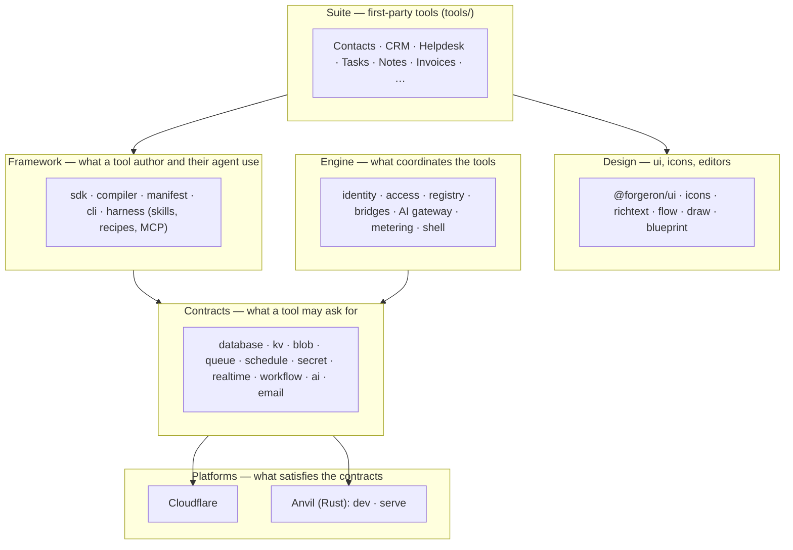
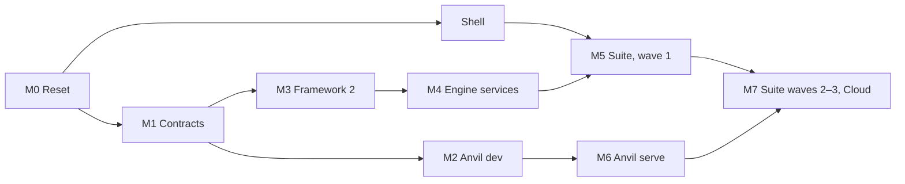

# Reframing Forgeron — state, target, roadmap

> Status: proposal (21 November 2026), written for the owner to validate. Nothing here is decided until it is recorded in [`DECISIONS.md`](DECISIONS.md). Six decisions are asked for in [§2](#2-decisions-to-take-first); the rest of the document assumes the recommended answer to each.

This document frames the next stage of Forgeron: what exists, what the product becomes, how the repository is cut, how work is issued to agents, and the roadmap with its issues. It replaces nothing yet: [`ARCHITECTURE.md`](ARCHITECTURE.md) and [`sdk.md`](sdk.md) stay authoritative for the code as it is.

How it was made: five read-only audits of the repository and four web studies (framework DX, runtime and contracts, ERP landscape and AI gateway, issue conventions). Claims about other projects are marked **[v]** when a primary source was fetched on 21 Nov 2026 and **[u]** when they come from memory and still need a check.

## 0. Owner's answers (21 November 2026)

These supersede the matching lines below, which are kept as written until the document is revised.

- **Positioning: a platform for internal tools. The word ERP is dropped**, inside as well as on the page. An ERP is a company's integrated ledger (accounting, purchasing, stock); Forgeron has the shared base of one, not its accounting core, and does not aim at it. Accounting is a non-goal. This settles D1.
- **`apps/console` is deleted.** This settles D2.
- **A customer keeps all its tools in one repository.** Catalog tools arrive there as starting points and are adjusted in place. One repository is what makes the tools coherent: bridges between them, one set of checks, tests across tools. A tool stays a unit of its own; it does not have to be coupled to the others.
- **The landing's opening is to be rebuilt.** The story is no longer the fall of an ERP but a company running on many disparate tools, none of which does quite what it wants. New issue R-07 in M0 (HITL): rewrite the opening animation and its captions, and decide what becomes of `/wild-erp`.

Second round, same day:

- **D3 settled: our own tools live in this repository under `tools/`.**
- **D4 settled: one binary, `anvil dev` and `anvil serve`.**
- **D5 settled (validated by the owner).** The owner wants a serverless-style runtime and asked for Deno and Bun to be compared with workerd by running them. Three spikes: [`spikes/runtime-workerd.md`](spikes/runtime-workerd.md), [`spikes/runtime-deno-bun.md`](spikes/runtime-deno-bun.md), [`spikes/runtime-landscape.md`](spikes/runtime-landscape.md). Decision, in [`next/runtime.md`](next/runtime.md): Anvil supervises `workerd`, **one process per tool, started on demand and stopped when idle**, with the data held by Anvil's own services. Deno is ruled out (its development ends in a year); Bun is the fallback; a shared `workerd` process is ruled out (one looping tool froze all the others).
- **D6 settled: D-085 stands** (Apache-2.0 for what a tool imports and runs, AGPL-3.0 for the platform), Anvil goes with the platform, and the site's copy is corrected.
- **D7 settled: a catalog tool is added by a pull request.** From the catalog, one button either adds the tool to the workspace's catalog as it is, or forks it: the platform opens a pull request that writes the tool's source into the customer's repository, at the place the repository's layout prescribes. See [`next/distribution.md`](next/distribution.md).
- **D8 settled: both repository shapes are supported, one is recommended.** A suite of tools that must be coherent and reach one another lives in one workspace repository; this is what `forgeron init` creates by default and what the documentation teaches. A tool that stands apart (a test, a niche tool for one person or one team, no interconnection) may live in a repository of its own. See [`next/framework.md`](next/framework.md).

Found while writing the contracts, and changing the size of M1: **of the six wave-1 resources, only the database reaches a deployed tool today.** The generated Worker passes `env.DB` and nothing else; `ctx.cache` throws, `ctx.files` does not exist, queues are not provisioned, no cron trigger is registered, and `ctx.secrets` is empty once deployed. M1 is therefore the first real implementation of five resources, not a change of vocabulary, and the landing shows them as available. Each contract's "Open questions" section lists what must be decided before its issue starts.

Found while choosing libraries, in [`next/libraries.md`](next/libraries.md): the gateway's OAuth provider is Cloudflare-only and has no drop-in replacement; no durable-workflow library fits both targets; several expected libraries are deprecated or stalled.

The documents that detail the target are indexed in [`next/README.md`](next/README.md); the contracts are in [`contracts/`](contracts/README.md).

## 1. Where we are

### 1.1 The repository in one table

| Layer             | What exists                                                                                                            | Size      | State                                                                    |
| ----------------- | ---------------------------------------------------------------------------------------------------------------------- | --------- | ------------------------------------------------------------------------ |
| Framework         | `sdk`, `manifest`, `compiler`, `runtime`, `permissions`, `scaffold`, `playground`, `apps/cli`                          | ~19k LOC  | Working, released (0.6.0). One tool definition → MCP, API, CLI, web.     |
| Engine            | `apps/gateway`, `registry`, `platform-contract`, `hosting`                                                             | ~55k LOC  | Working, released (0.8.4). Identity, teams, secrets, audit, marketplace. |
| Admin UI          | `apps/console`                                                                                                         | ~23k LOC  | Working, but its UX is the old "tool dashboard". To delete (§2, D2).     |
| Runtime target    | Cloudflare only: Workers, D1, KV, R2, one Durable Object for realtime; `local` mode is workerd                         | —         | No other target. No Rust runtime code anywhere.                          |
| Design            | `ui` (~220 components, shadcn registry), `icons`, `font`, `shaders`, `blueprint`, `canvas`, `flow`, `draw`, `richtext` | ~300k LOC | The most recent and most polished work (D-147 to D-164).                 |
| First-party tools | `templates/crm`, `inventory`, `dashboard`                                                                              | ~2.4k LOC | Three small tools; they double as the SDK's integration tests.           |
| Product intent    | `apps/site` (Pick / Shape / Ship), 20 HTML mocks in `docs/prototypes/`                                                 | —         | The mocks describe a 20-app suite; none of it is built.                  |
| Connectors        | `connector-microsoft-365` (thin), `connector-google-workspace` (stub)                                                  | ~135 LOC  | Barely started.                                                          |

### 1.2 What is solid and stays

- **The tool model.** `forgeron.config.ts` + `actions/` + `db/` + `views/`; an action is exposed on four interfaces with the same rights. Tool code only sees `ctx.*` and never imports a Cloudflare API.
- **Declared resources with approval.** A tool lists what it needs (`resources`), an admin approves, a new version asking for more is re-approved. This is already the "declare your dependencies" idea; only its vocabulary is Cloudflare-shaped.
- **Shared access.** `@forgeron/permissions` (subjects, teams, atomic permissions, D-137), SSO (OIDC, SAML), OAuth 2.1 with audience-bound tokens, per-person secrets, audit log, admin MCP that mirrors every console action (D-139).
- **The delivery chain.** Build in the tool's CI, deploy by token or OIDC, channels and per-branch previews, rollback, manifest diff with semver impact.
- **Tool-to-tool calls.** `uses: { crm: "^1.4.0" }` and `ctx.tools.crm.call()`, typed from the target's manifest, run as the caller. This is the seed of bridges.
- **The design system.** `@forgeron/ui` and the editors are ready to build a suite on.
- **The discipline.** `bun run check`, dependency-cruiser rules with a self-test, the decision log.

### 1.3 What is missing or in the way

1. **Cloudflare is in the vocabulary and in the engine.** The manifest says `engine: "d1"`; cache means KV, files means R2. `hosting` (45 Cloudflare call sites), `registry` (D1-shaped) and the gateway (`workers-oauth-provider`, a Durable Object) only run on Cloudflare. "Self-host" today means "your own Cloudflare account".
2. **No contracts.** Only the database has a typed surface (Kysely). Files, cache, queue and realtime have no specified semantics, and the queue resource is declared but barely implemented.
3. **No AI gateway, no budgets.** Usage is a call counter (D-093). There is no model-calling abstraction in the SDK.
4. **No kernel for business data.** Nothing shared across tools beyond identity: no common contact, no activity timeline, no attachments, search, custom fields, numbering or document generation.
5. **Bridges are calls only.** No typed events between tools, no cross-tool references, no sync framework for external systems.
6. **The suite is three demos.** The landing sells a catalog; the mocks show twenty apps.
7. **The documents disagree.** The landing opens on an ERP exploding and `/wild-erp` shows the ERP fainting; the white paper says "light and modular rather than integrated and heavy"; the README is still the SDK-first pitch with "Status: design"; the landing says Apache-2.0 while the gateway and console are AGPL-3.0; D-114 says business tools live outside this repository. No decision records the ERP direction.

## 2. Decisions to take first

Each has a recommendation. Together they are the content of one new entry in `DECISIONS.md` (D-165).

| #   | Question                                        | Recommendation                                                                                                                                                                                                                                                                                                           |
| --- | ----------------------------------------------- | ------------------------------------------------------------------------------------------------------------------------------------------------------------------------------------------------------------------------------------------------------------------------------------------------------------------------ |
| D1  | Is Forgeron "an ERP"?                           | **Inside: yes. On the page: no.** We build ERP-class coverage (a suite on one kernel), and we keep saying "Forge your internal tools". The landing's villain is the _monolithic, per-module-billed_ ERP; our answer is the same coverage as independent tools on a shared engine. The opening and `/wild-erp` stay true. |
| D2  | Delete `apps/console` now?                      | **Yes, in the first milestone**, replaced by a placeholder page. The admin MCP and the CLI already cover every admin action, so no capability is lost. A new shell is rebuilt later from `docs/prototypes/console-home.html`. Cost: the self-hosted install loses its screens until then.                                |
| D3  | Where do first-party tools live?                | **In this repository, under `tools/`** (reverses D-114 for first-party tools). The framework is about to break its API; the suite must break and be fixed in the same pull request. Split out when the SDK reaches 1.0.                                                                                                  |
| D4  | One Rust runtime or two (Anvil and a mini one)? | **One binary, `anvil`, two profiles**: `anvil dev` and `anvil serve`. Same code paths, different configuration (persistence, TLS, backups, limits), so one conformance suite covers both.                                                                                                                                |
| D5  | How does Anvil run TypeScript?                  | **It supervises `workerd`** (Cloudflare's open-source runtime, Apache-2.0 **[v]**) and implements our contracts in Rust behind it. We do not embed V8 ourselves and do not go to WASM now. See §4.3.                                                                                                                     |
| D6  | Licences                                        | Keep D-085 (Apache-2.0; AGPL-3.0 for the engine), put `anvil` under AGPL-3.0 with the engine, and fix the landing copy. Whether the engine should move to a fair-source licence is a business call left to the owner.                                                                                                    |

## 3. What Forgeron becomes

Five layers. The first three are the owner's words (engine, framework, platforms); the last two are what they carry.



The one structural idea: **contracts sit between everything we write and everything that runs it.** A tool declares needs in our vocabulary; a platform provides them. The engine itself (gateway, registry) is a consumer of the same contracts, which is what lets the whole product, not only the tools, run on Anvil.

| Deployment       | Platform                  | For whom                                                 |
| ---------------- | ------------------------- | -------------------------------------------------------- |
| Forgeron Cloud   | Cloudflare, our account   | Teams who want it run for them; one bill.                |
| Self-managed     | Cloudflare, their account | Exists today.                                            |
| Your own servers | `anvil serve`             | A machine or a VPS, no Cloudflare. Single node, backups. |
| Any laptop       | `anvil dev`               | Development, offline, and trying the suite in a minute.  |

## 4. Structure

### 4.1 Contracts

A new leaf package, `@forgeron/contracts`, holds for each contract three things:

1. **The TypeScript interface** — the normative surface, a small Cloudflare-shaped subset so the Cloudflare provider is a pass-through.
2. **A semantic specification** in `docs/contracts/<name>.md`: consistency, ordering, delivery, limits, error codes. Every guarantee has an id (`KV-03`).
3. **Conformance tests** in `@forgeron/conformance`, tagged by guarantee id and parameterised by provider. They run against workerd, against Anvil, and against real Cloudflare through a deployed probe Worker.

A contract states the **weakest** guarantee any provider gives, so a stronger provider stays compatible. Anvil's dev profile gets a chaos mode (redelivery, propagation delay) so tools do not come to depend on its stronger behaviour.

| Contract   | Mirrors                | Guarantee that matters                                           | Wave |
| ---------- | ---------------------- | ---------------------------------------------------------------- | ---- |
| `database` | D1                     | SQLite dialect, atomic batch, no interactive transaction (D-012) | 1    |
| `kv`       | KV                     | eventually consistent, last write wins, TTL                      | 1    |
| `blob`     | R2                     | strongly consistent, conditional and range reads                 | 1    |
| `queue`    | Queues                 | at-least-once, unordered, per-message ack, dead letters          | 1    |
| `schedule` | Cron triggers          | UTC, at-least-once                                               | 1    |
| `secret`   | secrets (ours, sealed) | never readable back                                              | 1    |
| `realtime` | a Durable Object room  | rooms, presence, at-most-once fan-out                            | 2    |
| `workflow` | Workflows              | memoised steps, sleep, wait for event                            | 2    |
| `ai`       | AI Gateway             | provider-neutral chat and embed, metered, budgeted               | 2    |
| `email`    | Email                  | send; receive later                                              | 2    |
| `actor`    | Durable Objects        | one instance per id, serialised, private storage                 | 3    |
| `search`   | Vectorize / FTS        | —                                                                | 3    |

Not contracts: Hyperdrive, Analytics Engine, Pipelines, Containers, service bindings, dispatch namespaces. They stay inside the Cloudflare provider.

Manifest change: `database({ engine: "d1" })` becomes `database()`; the manifest names contracts, never products. This is a manifest contract bump (4) with a mechanical migration.

### 4.2 Packages

Folders are not moved: a layer is a moon tag and an issue label, not a directory. New and changed pieces only:

| Package / app                   | Layer     | Role                                                                                                | Status |
| ------------------------------- | --------- | --------------------------------------------------------------------------------------------------- | ------ |
| `@forgeron/contracts`           | contracts | interfaces, error codes; depends on nothing                                                         | new    |
| `@forgeron/conformance`         | contracts | the provider test suite                                                                             | new    |
| `@forgeron/provider-cloudflare` | platform  | contracts over Workers bindings; takes the Cloudflare half of `runtime`                             | new    |
| `@forgeron/provider-anvil`      | platform  | the JS shims that run inside workerd and call Anvil's host services                                 | new    |
| `@forgeron/hosting`             | platform  | gains an `anvil` mode beside `cloud` and `self-host`; `local` is retired                            | rework |
| `@forgeron/runtime`             | framework | becomes provider-neutral: takes a provider, never reads `env.DB`                                    | rework |
| `@forgeron/sdk`                 | framework | `defineModel`, bridges, `ctx.ai`, `ctx.workflow`; see §4.4                                          | rework |
| `@forgeron/bridges`             | engine    | links, the event outbox, the sync-connector frame                                                   | new    |
| `@forgeron/ai-gateway`          | engine    | keys, budgets, allow-lists, metering; two backends                                                  | new    |
| `@forgeron/metering`            | engine    | usage events and budgets, one unit ("Fuel" on the pricing page)                                     | new    |
| `@forgeron/kernel`              | engine    | record services shared by tools: activity, attachments, search, sequences, custom fields, documents | new    |
| `@forgeron/harness`             | framework | skills, recipes, `llms.txt`, lint rules; what an agent loads to work on a tool                      | new    |
| `apps/shell`                    | engine    | the workspace UI, rebuilt from the `console-home` mock on `@forgeron/ui`                            | new    |
| `apps/console`                  | —         | deleted                                                                                             | delete |
| `tools/*`                       | suite     | first-party tools; `templates/` is renamed                                                          | rename |
| `crates/anvil*`                 | platform  | §4.3                                                                                                | new    |

Dependency rules to add: `contracts` is a leaf; tools and `sdk` import no provider; a provider imports `contracts` and nothing else of ours; `kernel`, `bridges`, `ai-gateway` and `metering` never import the gateway.

### 4.3 Anvil

One Rust binary, in `crates/`:

| Crate              | Role                                                                                               |
| ------------------ | -------------------------------------------------------------------------------------------------- |
| `anvil`            | the binary: `anvil dev`, `anvil serve`, `anvil backup`, `anvil update`                             |
| `anvil-supervisor` | downloads a pinned workerd, writes its configuration per tool, starts and watches it               |
| `anvil-host`       | the contract services over a local socket: SQLite files (one per tool and channel), blob store, kv |
| `anvil-jobs`       | queue, schedule and workflow engines on SQLite tables                                              |
| `anvil-front`      | HTTP entry (axum), WebSockets, TLS and ACME in the `serve` profile                                 |

Why supervise workerd instead of embedding a JavaScript engine:

- It is the real runtime, so the same bundle runs on both targets without us chasing the Workers API. It is Apache-2.0 and positioned by its README for self-hosting **[v]**.
- The alternatives cost more than they give. `deno_core` was archived in April 2026 and folded into the Deno repository **[v]**; OpenWorkers shows how long the tail of a hand-made Workers runtime is **[v]**; WinterJS and Lagon are archived **[v]**; the WASI storage interfaces are still at proposal phase 1–2 **[v]**.
- The Rust we write is then plain services (SQLite, files, timers, a job journal), which agents write well.

Known costs, stated up front:

- workerd is **not a security boundary** (its README says so **[v]**). Anvil hosts the customer's own tools; untrusted third-party tools need a process or VM boundary, which is out of scope.
- About 100 MB, a glibc 2.35 floor on Linux, daily upstream releases **[v]**. Anvil pins one workerd version per release and the conformance suite gates the bump.
- Single node. `anvil serve` promises backups (WAL shipping to object storage, snapshots) and a tested restore, not high availability.

Worth a spike before the actor contract: Rivet (Rust control plane, TypeScript actors, Apache-2.0, pitched as a self-hostable Durable Objects alternative **[v]**).

### 4.4 Framework, second version

Sources of inspiration, each for one idea:

| Idea                                                                                                  | From                                 | For Forgeron                                                                                       |
| ----------------------------------------------------------------------------------------------------- | ------------------------------------ | -------------------------------------------------------------------------------------------------- |
| One entity per file, a single `defineX` default export; the path is the registry                      | Twenty apps, Vercel eve **[v]**      | Already our shape for actions; extend to models, views, links, jobs, workflows.                    |
| Infrastructure declared in code, the declaration is also the typed handle                             | Encore, Alchemy **[v]**              | `resources` is this; keep it, drop the product names.                                              |
| Schema as the single source                                                                           | Convex, Frappe **[v] / [u]**         | `defineModel` yields the table, validators, default form and list, permissions, MCP schema.        |
| Modules never touch each other's tables; a link is a third artifact                                   | Medusa v2 **[v]**                    | Bridges, §4.5.                                                                                     |
| A plugin is a typed contribution (schema, actions, hooks, views), with client types by inference      | Better Auth **[v]**                  | The landing's "plugins" (`Soon`). Not Payload's config-in, config-out, which can rewrite anything. |
| `plan` then `apply`, every command with `--json` and `--yes`                                          | Twenty, Alchemy, Better Auth **[v]** | `forgeron plan` shows resources, migrations and permission changes before a deploy.                |
| `add <capability>` writes the file and provisions the resource                                        | Vercel eve **[v]**                   | `forgeron add queue`, `forgeron add model invoice`.                                                |
| `llms.txt`, a Markdown copy of each docs page, an installable skills pack, lint rules for conventions | Better Auth, Convex, Twenty **[v]**  | `@forgeron/harness`.                                                                               |
| UI is code, so an agent can generate and refactor it                                                  | Ivy **[v]**                          | Views stay React on `@forgeron/ui`; no XML view layer, the opposite of Odoo.                       |

Rules for the API:

- Inference first; generated files only where inference cannot reach, regenerated by `dev` and checked in CI.
- Every definition is validated at load time; an error names the file, the declaration and the fix, with a stable code and a `--json` form.
- Idempotency keys are a primitive of queues, workflows and bridges, since all three are at-least-once.
- Recipes (the landing's `Soon`) are skills: a `RECIPE.md` with its schema, action, view and test, shipped in `@forgeron/harness` or with a tool.

### 4.5 Bridges

A bridge is a declared, versioned contract between two tools, or between a tool and an outside system. Three forms:

1. **Calls** — `uses` and `ctx.tools.x.call()`. Exists.
2. **Events** — a tool publishes typed, versioned events; another subscribes. Delivery is at-least-once through an outbox in the publisher's database. `on()` exists for a tool's own events; this extends it across tools.
3. **Links** — `defineLink(crm.deal, invoices.invoice)` creates a link table owned by the engine, with no foreign key in either tool, an alias on each side and a deletion policy. A graph read crosses it, and the permission check runs on each side at read time.

Sync connectors (Odoo, Microsoft 365, Google Workspace, Notion) are the same frame pointed outward: direction, conflict policy, idempotency keys, a rate budget, a dry run.

Pitfalls to design against: dangling references, echo loops in two-way sync, a link revealing a record its reader cannot open, schema drift on upgrade.

### 4.6 AI gateway

One entry for every model call, from tools (`ctx.ai`) and from people's agents.

- Keys minted per team and per tool, revocable.
- Budgets by workspace, team, tool and person, with a daily and a monthly window; when spend cannot be verified the call is refused (LiteLLM's fail-closed behaviour **[v]**).
- Model allow-lists as groups. Provider failover. Bring your own key.
- A log policy per workspace: off, metadata, full.
- Every call emits a metering event; the same events feed usage screens and the invoice.

Two backends behind one interface: on Cloudflare, AI Gateway does routing, caching, logging and key storage, and its spend limits can be scoped by custom metadata **[v]**; on Anvil, a small proxy in Rust. Budgets and permissions stay in our engine on both, because they are the product.

### 4.7 The suite

The kernel services a tool gets by declaring them on a model: an activity timeline, attachments, search, custom fields, numbering sequences, document generation, import and export. Shared entities are tools, not kernel: **Contacts** (people and organisations) is the first tool and most others link to it.

| Wave | Tools                                                         | Why this order                                                       |
| ---- | ------------------------------------------------------------- | -------------------------------------------------------------------- |
| 1    | Contacts, CRM, Helpdesk, Tasks, Notes                         | The landing's catalog; exercises links, events, richtext, activity.  |
| 2    | Invoices, Drive, Forms, Flows, People and Time off, Expenses  | Money and documents: sequences, PDF, workflow, blob.                 |
| 3    | Mail, Agenda, Chat, Sign, Portal, Board, Data hub, Dashboards | Heavy realtime or external protocols; need `actor`, `email` receive. |

Each tool is built from its mock in `docs/prototypes/`. Not promised: accounting localisation per country, payroll.

## 5. How we work

### 5.1 Skills

- **Adopt** `mattpocock/skills` (MIT **[v]**), several of which are already installed here: `to-spec`, `to-tickets`, `grilling`, `tdd`, `domain-modeling`, `code-review`, `pr`, `writing-for-agents`. Its ticket model (vertical slices, native blocked-by links, a `ready-for-agent` label) is the base of ours.
- **Take two ideas** from `obra/superpowers` (MIT **[v]**): verification before completion, one git worktree per agent.
- **Skip** GitHub spec-kit (MIT **[v]**): a second directory of specs and a Python toolchain for what the above already gives.

### 5.2 Three levels

| Level     | GitHub object                          | Size                                             | Written by           |
| --------- | -------------------------------------- | ------------------------------------------------ | -------------------- |
| Milestone | milestone                              | an outcome a person can see                      | owner                |
| Project   | issue of type Feature, with sub-issues | a deliverable; has a spec when it is not obvious | owner with an agent  |
| Slice     | sub-issue of type Task                 | one agent, one pull request, a day or two        | agent, owner reviews |

A slice is **vertical**: it crosses the layers it needs and can be checked on its own. It is described by behaviour, not by files to edit. A wide refactor is cut as expand, migrate, contract.

### 5.3 The slice template

```markdown
## What to build

The behaviour once this is done, from the point of view of who uses it.

## Context

Parent project, decisions (D-n), spec sections, the mock if any. Where to start reading.

## Out of scope

What a reasonable agent might do and should not.

## Acceptance

- [ ] Checkable statements, tests included.

## Verification

The exact commands: `vitest <paths>`, `cargo test -p <crate>`, the conformance suite, `bun run check`.

## Mode

AFK (an agent finishes alone) or HITL (names the decision a person must take, and when).
```

Blocked-by is a native dependency link, not a line of text. A project issue has: outcome, appetite, slices, risks, exit criteria.

### 5.4 Labels and types

- Types: Feature (project), Task (slice), Bug.
- `layer:engine` · `layer:framework` · `layer:contracts` · `layer:platform` · `layer:suite` · `layer:design` · `layer:docs`
- `mode:afk` · `mode:hitl`
- `ready-for-agent` · `needs-human`
- `spike` for a question whose output is a document in `docs/spikes/`

### 5.5 Rules for an agent

1. One slice, one branch (`feat/<issue>-<slug>`), one pull request that says `Closes #n`. One worktree per agent.
2. Read the issue, the parent, the decisions it cites. Do not widen the scope: note what you find in a new issue.
3. Tests first where the slice has behaviour. Run `vitest` on touched files while working, `bun run check` once before pushing.
4. **Stop and ask** (comment, `needs-human`) when the slice needs a change to the public API in `sdk.md`, to a contract's semantics, to a dependency rule, to the manifest schema, or when acceptance is ambiguous.
5. A choice between two real options is a decision: add it to `DECISIONS.md` in the same pull request.
6. A new package, app or crate comes with its `moon.yml`, its `tsconfig.json` and its line in `ARCHITECTURE.md`.
7. The pull request states what was verified and what was not.

GitHub mechanics (endpoints **[v]**, under API version `2026-03-10`; ids are numeric issue ids, not numbers):

```bash
gh api repos/forgeron-sh/monorepo/issues/CHILD --jq .id
gh api -X POST repos/forgeron-sh/monorepo/issues/PARENT/sub_issues -F sub_issue_id=ID
gh api -X POST repos/forgeron-sh/monorepo/issues/N/dependencies/blocked_by -F issue_id=BLOCKER_ID
```

Setting an issue's type through `gh` is **[u]** and is checked in R-03.

## 6. Roadmap



M2 and M3 run in parallel once M1 has frozen the manifest. The shell starts as soon as the console is gone.

### M0 — Reset

The repository says what we are building, and the old surface is gone.

| Id   | Issue                                                                                                                             | Mode |
| ---- | --------------------------------------------------------------------------------------------------------------------------------- | ---- |
| R-01 | Done: D-165 records the eight decisions                                                                                           | HITL |
| R-02 | Delete `apps/console`; the gateway serves a placeholder; build, CI, release artifact and knip follow; `console-ux.md` archived    | AFK  |
| R-03 | Issue forms, labels, types, milestones as in §5; `CONTRIBUTING.md` and `AGENTS.md` carry the rules; install and set up the skills | AFK  |
| R-04 | Rewrite `README.md`, `white-paper.md` and `ARCHITECTURE.md` to the five layers; fix the licence line on the site                  | HITL |
| R-05 | Rename `templates/` to `tools/`; drop `dashboard` or fold it into CRM; dependency rules and CI follow                             | AFK  |
| R-06 | Add layer tags to every `moon.yml` and the dependency rules of §4.2 with their self-tests                                         | AFK  |

### M1 — Contracts

A tool's manifest names no Cloudflare product, every wave-1 resource works on a deployed tool, and the suite proves a provider. Today only the database does (§0); this milestone is the first implementation of the five others. The specifications are drafted in [`contracts/`](contracts/README.md).

| Id   | Issue                                                                                                                                                                                                                               | Mode |
| ---- | ----------------------------------------------------------------------------------------------------------------------------------------------------------------------------------------------------------------------------------- | ---- |
| C-01 | Settle the open questions of the six contracts in `docs/contracts/` (queue outbox, one schedule trigger on the gateway, gateway-signed blob links, secrets per channel, `ttl` floor, no read sessions); mark each contract accepted | HITL |
| C-02 | `@forgeron/contracts`: wave-1 interfaces and error codes, as accepted                                                                                                                                                               | AFK  |
| C-03 | `@forgeron/conformance`: the suite, one test per guarantee id, run against workerd in CI                                                                                                                                            | AFK  |
| C-04 | `@forgeron/provider-cloudflare`; `runtime` takes a provider; the compiler's generated entry passes every declared resource, not only `env.DB`                                                                                       | AFK  |
| C-05 | Manifest contract 4: neutral resource vocabulary, migration of the tools, `sdk.md` updated                                                                                                                                          | HITL |
| C-06 | `kv` and `blob` on Cloudflare: `ctx.cache` and `ctx.files` work on a deployed tool; size and type limits enforced                                                                                                                   | AFK  |
| C-07 | `queue` on Cloudflare: provisioning, consumer, ack, retry, dead letters, with the outbox                                                                                                                                            | AFK  |
| C-08 | `schedule` on Cloudflare: tasks fire on a deployed tool; the daylight-saving bug fixed                                                                                                                                              | AFK  |
| C-09 | `secret`: values reach a deployed tool; a permanent channel has its own secrets                                                                                                                                                     | AFK  |
| C-10 | A probe Worker and a scheduled job that run the suite against real Cloudflare                                                                                                                                                       | AFK  |
| C-11 | Site: the resources shown as available match what is; `Soon` on the rest until C-06 to C-09 land                                                                                                                                    | AFK  |
| C-12 | Wave 2 specifications and interfaces: `realtime`, `workflow`, `ai`, `email`                                                                                                                                                         | HITL |

### M2 — Anvil dev

`forgeron dev` runs a workspace on Anvil, offline, and the conformance suite is green on it. The design is [`next/runtime.md`](next/runtime.md): workerd supervised, one process per tool, started on demand (D5).

| Id   | Issue                                                                                                                                                                                 | Mode |
| ---- | ------------------------------------------------------------------------------------------------------------------------------------------------------------------------------------- | ---- |
| A-01 | Verify on Linux x64 and arm64 what the spike measured on macOS, and the five points of `next/runtime.md` §8; go or no-go on the pinned workerd                                        | HITL |
| A-02 | `anvil-supervisor`: pinned workerd download checked against our own hash, one configuration and one process per tool, start on demand, idle stop, memory cap, watchdog with `SIGKILL` | AFK  |
| A-03 | `anvil-front` and the router: a request wakes a stopped tool and is held meanwhile; WebSockets survive                                                                                | AFK  |
| A-04 | `anvil-host`: `database` over D1's protocol on SQLite files, one per tool and channel; `provider-anvil` builds `env`                                                                  | AFK  |
| A-05 | `anvil-host`: `kv`, `blob`, `secret`                                                                                                                                                  | AFK  |
| A-06 | `anvil-jobs`: `queue` and `schedule`, delivered by calling the tool                                                                                                                   | AFK  |
| A-07 | `hosting` gains the `anvil` mode; `forgeron dev` runs the whole workspace on it; the `local` mode is removed                                                                          | AFK  |
| A-08 | The gateway and registry run on Anvil: a portable OAuth provider in place of `workers-oauth-provider`, restore points, the realtime object                                            | HITL |
| A-09 | Chaos mode: redelivery and delayed reads behind a flag                                                                                                                                | AFK  |
| A-10 | Release: cross-compiled binaries, checksums, `npx forgeron` fetches the right one                                                                                                     | AFK  |
| A-11 | `realtime` and `workflow` on Anvil                                                                                                                                                    | AFK  |

### M3 — Framework 2

An agent given one sentence adds a model, a view and a bridge to a tool, and the checks tell it when it is wrong.

| Id   | Issue                                                                                                              | Mode |
| ---- | ------------------------------------------------------------------------------------------------------------------ | ---- |
| F-01 | Spec: `defineModel` and the file conventions, written into `sdk.md` after a grilling session                       | HITL |
| F-02 | `defineModel`: table, validators, default list and form, MCP schema from one definition                            | AFK  |
| F-03 | Load-time validation and the error catalogue: code, file, fix, `--json`                                            | AFK  |
| F-04 | `forgeron plan` and `apply`; `--json` and `--yes` on every command                                                 | AFK  |
| F-05 | `forgeron add` for resources, models, views, jobs                                                                  | AFK  |
| F-06 | `@forgeron/harness`: skills pack, lint rules, `llms.txt`, Markdown docs; the scaffolded `AGENTS.md` points at them | AFK  |
| F-07 | Plugins: the typed contribution contract and one real plugin (kanban on any model)                                 | HITL |
| F-08 | Recipes: the format and three recipes (add a field, a renewal page, a weekly digest)                               | AFK  |
| F-09 | Testing harness: in-memory providers, a typed test client, fixtures                                                | AFK  |

### M4 — Engine services

What makes separate tools one product.

| Id   | Issue                                                                                               | Mode |
| ---- | --------------------------------------------------------------------------------------------------- | ---- |
| E-01 | Bridges, events: versioned schemas, the outbox, cross-tool subscription                             | AFK  |
| E-02 | Bridges, links: `defineLink`, the link store, graph read with permission checks                     | HITL |
| E-03 | `@forgeron/metering`: usage events, the unit, budgets and their enforcement                         | HITL |
| E-04 | `@forgeron/ai-gateway`: the interface, `ctx.ai`, keys, budgets, allow-lists; the Cloudflare backend | AFK  |
| E-05 | The AI gateway's Anvil backend                                                                      | AFK  |
| E-06 | `@forgeron/kernel`: activity timeline and attachments                                               | AFK  |
| E-07 | `@forgeron/kernel`: search, custom fields, sequences                                                | AFK  |
| E-08 | `apps/shell`: frame, navigation, inbox, installed tools, from the `console-home` mock               | HITL |
| E-09 | `apps/shell`: administration — members, teams, access, vault, usage and budgets, audit              | AFK  |
| E-10 | Record-level permissions: the model and its check on every interface                                | HITL |
| E-11 | Sync connectors: the frame, and Microsoft 365 contacts as the first                                 | AFK  |

### M5 — Suite, wave 1

| Id   | Issue                                                                          | Mode |
| ---- | ------------------------------------------------------------------------------ | ---- |
| S-01 | Contacts: people and organisations, the entity others link to                  | AFK  |
| S-02 | CRM rebuilt on framework 2 from `crm.html`, linked to Contacts                 | AFK  |
| S-03 | Helpdesk from `helpdesk.html`                                                  | AFK  |
| S-04 | Tasks from `tasks.html`                                                        | AFK  |
| S-05 | Notes from `notes.html`, on `@forgeron/richtext`                               | AFK  |
| S-06 | The demo workspace: seeded data, the five tools bridged, runs with `anvil dev` | AFK  |

### M6 — Anvil serve

| Id   | Issue                                                                               | Mode |
| ---- | ----------------------------------------------------------------------------------- | ---- |
| V-01 | `anvil serve`: TLS and ACME, the front, limits                                      | AFK  |
| V-02 | Backups: WAL shipping to object storage, snapshots, `anvil restore`, a restore test | AFK  |
| V-03 | Install and self-update on a server; `docs/self-host.md` rewritten                  | AFK  |
| V-04 | Observability: traces and logs to OpenTelemetry                                     | AFK  |
| V-05 | A written threat model for running tools on workerd without a second boundary       | HITL |

### M7 — Later

Suite waves 2 and 3; Forgeron Cloud on Workers for Platforms with billing; the `actor` and `search` contracts; untrusted third-party tools on Anvil.

## 7. Risks

1. **Breadth.** Twenty apps invite a comparison with Odoo that we lose on count. Five tools that work together, then the next six.
2. **The engine on Anvil (A-06).** Tools port easily; the gateway uses Cloudflare-specific pieces. This is the least known part of the plan and is spiked early.
3. **Agent-written customisations breaking on upgrade.** A stable public API, the manifest diff we already have, and customer tools tested against each release.
4. **Contract drift between providers.** The conformance suite against real Cloudflare (C-07) is not optional.
5. **Deleting the console before the shell exists.** Accepted; the admin MCP covers it meanwhile.

## 8. Still to verify

- The competitive table beyond Odoo, Frappe, Twenty, Medusa, LiteLLM and Cloudflare is from memory **[u]**.
- Whether open-source workerd includes dynamic loading of tenant Workers, which decides how Anvil loads many tools.
- Vercel eve's release status (its docs say beta, its blog says 1.0) and its folder conventions.
- "Ivy" was read as Ivy Framework (Ivy-Interactive); the owner may have meant another project.
