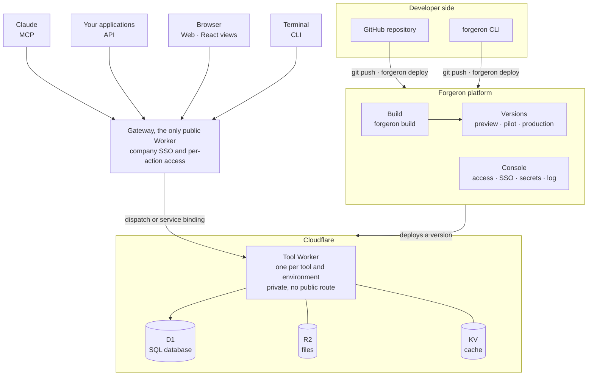
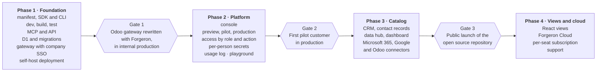

# Forgeron — White paper

October 20, 2026 · Ely Delva · Working draft

## Summary

Forgeron is an open source platform to write, version, host and govern a company's internal tools. A developer describes a tool once with the SDK — its data, its actions, its permissions — and Forgeron automatically exposes it through four interfaces: **MCP** for Claude, **API**, **Web** and **CLI**.

The bet: tomorrow, teams will work with their business tools through an assistant like Claude first. The heavy interface of an ERP then loses its value; what matters is reliable data and well-defined actions, with the right permissions. Forgeron provides exactly that layer, lightweight, on Cloudflare Workers.

Three things to remember:

- **A way of writing tools, not just an SDK.** Forgeron enforces one light, single shape: a config file, tables, actions, views. All tools look alike, so all tools stay maintainable.
- **A production platform.** Every push to GitHub creates a version, deployed to preview, pilot or production. Access by role and by action, enterprise SSO, usage log.
- **Ready-to-use tools.** A catalog of light templates (CRM, contact records, data hub, API gateways like Odoo) that the company launches as they are or forges to fit.

Forgeron is distributed as self-host (open source, on the company's own Cloudflare account) or as cloud, with a single per-seat subscription.

## The problem

Companies pay for giant software suites while using a fraction of them, and their real internal tools live elsewhere, with no framework.

**1. ERPs cost a lot for what they deliver.** A suite like Odoo is paid per module and per user. It imposes its interface, its data model and its integrations. For a simple need — tracking contacts, leads, requests — the company buys an entire system.

**2. The interface is changing.** Teams are starting to work from Claude or another assistant. They ask a question, request an action, and no longer open the application. At that point, it doesn't matter whether there is an ERP behind it: the data and the actions just have to respond, reliably and with the right permissions.

**3. Homemade internal tools are not industrialized.** Each internal developer writes their own scripts, their own small MCP server, their own admin page, each in their own way. The result:

- no versions and no test environment;
- no consistent access management, with API keys circulating;
- no visibility into who uses what;
- a tool that dies when its author changes jobs.

**4. Plugging an AI assistant into company data is still a craft job.** The in-house Odoo MCP gateway shows it: it takes SSO authentication, per-person key storage, a gateway to the API, a deployment. It's doable, but every team reinvents it.

None of these problems is technically hard. What's missing is a **standard way** to write, deploy and govern these tools.

## The vision

Forgeron aims to be **the last platform a company needs for its internal tools**: the place where they are forged, where they run, and where you decide who has access.

Four convictions guide the product:

1. **Backend first, interface second.** The core of a tool is its data and its actions. Once defined, they are served everywhere: to Claude through MCP, to other software through the API, to a human through the terminal or a web page. Forgeron's first deliverable is therefore a backend; views come as a complement.
2. **Claude is a desirable interface.** Talking to your tools is faster than learning a screen. But a conversation doesn't replace everything: for a sales pipeline or a dashboard, a light React view, fed by the same actions, keeps its place.
3. **Light and modular rather than integrated and heavy.** A light CRM, a light contact record, a light data hub: each tool does one thing, changes without risk and costs little to run.
4. **An enforced shape, in service of simplicity.** Forgeron doesn't leave a hundred ways to write a tool. It offers one, short and readable, that every developer in the company recognizes. That is what makes tools maintainable, transferable and governable.

The name carries the idea: internal developers come to **forge** their own tools from bases, templates and building blocks that already exist, instead of depending on a suite that decides for them.

## The product

Forgeron is made of six building blocks. The first three are open source and are enough to run a tool; the next three provide the value in use.

| Block                  | What it is                                                                                                                                                          | For whom              |
| ---------------------- | ------------------------------------------------------------------------------------------------------------------------------------------------------------------- | --------------------- |
| **SDK** (`forgeron`)   | TypeScript library to declare a tool: config, tables, migrations, actions, permissions, views, connectors, scheduled jobs                                           | Developer             |
| **CLI** (`forgeron …`) | `init`, `dev`, `play`, `test`, `build`, `deploy`, `db`, `secrets`, `logs` — the whole lifecycle from the terminal, and every action of a tool callable as a command | Developer, power user |
| **Runtime**            | The layer that runs a tool on Cloudflare Workers and serves its four interfaces (MCP, API, Web, CLI)                                                                | —                     |
| **Console**            | The workspace dashboard: tools, versions, environments, access by role and by action, SSO, secrets, usage log                                                       | Admin, IT lead        |
| **Template catalog**   | Ready-to-launch tools: light CRM, contact records, data hub, API gateway (e.g. Odoo) — launched as they are or forked                                               | The whole company     |
| **Connectors**         | Building blocks to reach common services (Microsoft 365, Google, Odoo, etc.) with delegated authentication                                                          | Developer             |

### The playground: `forgeron play`

A space to try a tool without writing a client: the list of its actions, a generated form for each one, the result, and a preview of what Claude, the API and the CLI see of it. Locally, it opens with `forgeron play`; in the console, it lets you discover the catalog templates before launching them.

### What Forgeron doesn't reinvent

The rule: reuse what already exists whenever it is good, and build only what gives the Forgeron shape.

- **Reused**: Cloudflare Workers and its ecosystem (D1, R2, KV, Durable Objects), Kysely for typed SQL queries, Zod for schemas, Vitest for tests, React for views, the MCP protocol.
- **Built by Forgeron**: the structure of a tool, the migration system, the build (`forgeron build`), the generation of the four interfaces from a single action, the permission model, versioning and environments.

## How it works

A Forgeron tool is a folder in a fixed format; an action declared once becomes an MCP tool, an API route, a CLI command and data available to views.

### The anatomy of a tool

```text
crm/
├── forgeron.config.ts      # name, interfaces, roles, connectors
├── db/
│   ├── schema.ts           # tables, in TypeScript
│   └── migrations/         # generated by forgeron db generate
├── actions/                # one action per file
├── views/                  # React pages (optional)
├── tests/                  # Vitest
└── .forgeron/              # link to the workspace (committed) + local (ignored)
```

The SDK details, with complete examples (CRM, Odoo gateway, contact records), are in [`sdk.md`](sdk.md) and the [`examples/`](examples/) folder.

### One action, four interfaces

| Interface | What the user gets                                   | Example for `contacts.search`                      |
| --------- | ---------------------------------------------------- | -------------------------------------------------- |
| MCP       | A tool Claude can call, described and typed          | `crm_contacts_search`                              |
| API       | An authenticated HTTP route, with an OpenAPI schema  | `POST acme.forgeron.app/t/crm/api/contacts.search` |
| CLI       | A command, with generated help                       | `forgeron crm contacts search "Durand"`            |
| Web       | A hook for React views, and a form in the playground | `useAction("contacts.search")`                     |

The action's description, input schema and access level serve all four. A change in the code spreads everywhere in the next version.

### The lifecycle

1. **Develop** locally with `forgeron dev`: the tool runs as it does in production, database included, with its local MCP server.
2. **Push** to GitHub: every push creates an immutable version, and every branch a preview.
3. **Open as a pilot** a version to a specific group, to test it in real conditions.
4. **Promote** to production from the console or with `forgeron deploy --env production`.
5. **Roll back** in one click if needed: the previous version is always available.

### Access

Everyone signs in through the company SSO. The admin assigns roles; each action declares an access level (read, write, delete or a level specific to the tool); the console maps role × action. The same check applies whatever the interface: asking Claude gives no more rights than calling the API.

## Technical architecture

Forgeron is a layer on top of Cloudflare Workers: the platform builds and versions the tools, Cloudflare runs them, and an identity gateway checks every call.



Requests flow from the interfaces through the gateway to the tool Worker; code flows down from the repository to Cloudflare. The detailed diagram of the repository and the platform is in [`ARCHITECTURE.md`](ARCHITECTURE.md).

### Technical choices

| Layer               | Choice                                                                                         | Why                                                                      |
| ------------------- | ---------------------------------------------------------------------------------------------- | ------------------------------------------------------------------------ |
| Execution           | Cloudflare Workers; Workers for Platforms in the Forgeron cloud, standard Workers in self-host | Instant startup, low cost, isolation per tool                            |
| Database            | Cloudflare D1 (SQLite), queried with Kysely                                                    | Typed SQL without a heavy ORM; one database per tool and per environment |
| Migrations          | Forgeron's own system, on top of Kysely                                                        | Generated from the schema, applied on every deployment, reversible       |
| Files, cache, state | R2, KV, Durable Objects                                                                        | Cloudflare's native building blocks, exposed by the SDK                  |
| Schemas             | Zod                                                                                            | One schema to validate, type and generate MCP, OpenAPI and CLI help      |
| Build               | `forgeron build`, Forgeron's own (an existing bundling engine underneath)                      | A single output: the Worker, the action manifest, the views              |
| Tests               | Vitest, with a test context provided by the SDK                                                | Don't reinvent; in-memory local database                                 |
| Local dev           | `forgeron dev`, on Cloudflare's local runtime                                                  | The same behavior as in production                                       |
| Views               | React, with SDK hooks                                                                          | Data arrives with the signed-in person's permissions                     |

## Security and governance

An internal tool handles company data: Forgeron makes security a property of the shape, not an option left to each developer.

- **Single identity.** Sign-in through the company SSO (Microsoft Entra ID, Google Workspace, SAML/OIDC) for the console, the views, the API and the MCP server. The CLI authenticates with `forgeron login`, through the browser.
- **Declarative permissions.** Each action carries its access level in the code; no action is exposed without one. The console sets the roles × actions mapping, without redeploying.
- **Secrets separate from code.** Two levels: the tool's secrets (`forgeron secrets set`), encrypted on the platform side, and per-person secrets — for example each employee's Odoo API key, entered once at sign-in and never visible to the developer.
- **Isolation.** Each tool and each version runs in its own Worker, with its own database. A preview never has access to production data, unless explicitly chosen.
- **Usage log.** Every action call is traced: who, when, through which interface (Claude, API, Web, CLI), with what result. The admin sees who uses which tool and can revoke access immediately.
- **No security by prompt.** What Claude can do is bounded by the signed-in person's permissions, server-side. An instruction slipped into a conversation cannot widen those permissions.
- **Sovereignty.** In self-host, everything runs on the company's Cloudflare account: Forgeron has no access to the data.

## Who it's for

The primary target: companies that have at least one in-house developer, already use an AI assistant and find their ERP too heavy for their needs.

### Segments

| Segment                                  | Their situation                                       | What Forgeron brings them                                       |
| ---------------------------------------- | ----------------------------------------------------- | --------------------------------------------------------------- |
| SMBs and mid-caps with a small tech team | An expensive ERP, simple needs, one or two developers | Replace modules with light tools, usable from Claude            |
| IT teams and CIO offices                 | Homemade scripts and MCP servers, without governance  | A single framework: versions, access, SSO, log                  |
| Agencies and integrators                 | Custom tools delivered to several clients             | A common base, deployable at each client, in self-host or cloud |
| Startups and product teams               | A back office to build fast                           | Ready-to-fork templates and a complete stack from day one       |

### Personas

- **The internal developer** forges and maintains the tools. They want a simple stack, a CLI that does everything, tests and a one-command deployment.
- **The admin or IT lead** governs. They want to know who accesses what, plug in SSO once, revoke access in one click.
- **The business user** — sales, support, management — doesn't see Forgeron. They talk to Claude, open a view, and their tools respond.
- **The decision maker** — executive, CFO — compares the cost of an ERP with the cost of a single subscription and of tools that do exactly what's needed.

## Business model and open source

Forgeron is open source to earn developers' trust, and earns its revenue on hosting and governance, with a single plan per seat.

|                 | Self-host                                       | Forgeron Cloud                                                                     |
| --------------- | ----------------------------------------------- | ---------------------------------------------------------------------------------- |
| What's included | SDK, CLI, runtime, templates                    | Everything in self-host, plus the hosted console, SSO, managed connectors, support |
| Where it runs   | The company's Cloudflare account                | Our infrastructure, on Cloudflare                                                  |
| Cost            | Free; the company pays Cloudflare               | A single subscription per seat per month: [PRICE TO BE SET]                        |
| For whom        | Autonomous tech teams, sovereignty requirements | Companies that want it to just work, without operating it                          |

Why a single plan: the promise is the opposite of the per-module ERP. One seat gives access to all the tools in the workspace, all the templates and all the interfaces. The team has floated a figure of around €20 per person per month; it remains to be validated against infrastructure costs and the market.

Possible additional revenue, to be studied: support for building custom tools, premium templates, extended support for self-host.

**License**: to be chosen. A permissive license (MIT, Apache 2.0) maximizes adoption; an AGPL or source-available license protects the cloud against resale by a third party.

## Positioning

Forgeron sits between the ERP you buy and the code you write alone: code, but within a production framework, designed to be used from Claude.

| Alternative                      | What it does well                     | What's missing, and what Forgeron brings                                    |
| -------------------------------- | ------------------------------------- | --------------------------------------------------------------------------- |
| ERPs and business suites         | Broad functional coverage             | Lightness, cost, a free interface, native access from Claude                |
| Low-code internal tool platforms | Build screens fast                    | Backend first, real versioned code, native MCP and CLI, open source         |
| Homemade MCP servers             | Plug an assistant into an API quickly | Versions, access, SSO, per-person secrets, log, deployment                  |
| A hand-written Cloudflare Worker | Performance and cost                  | A standard shape, the database, migrations, the four interfaces, governance |

What makes Forgeron defensible is the **enforced shape**. The more tools a company has written the same way, the more valuable the catalog, the connectors and the console become, and the simpler it gets to write one more.

## Proposed roadmap

We start with the developer foundation and prove it on a real case, the Odoo MCP gateway already built in-house, before opening the platform to customers.



Dates are yet to be set; each phase starts only once the previous gate is passed. Identity (company SSO) belongs to phase 1, because gate 1 needs the gateway to sign people in; what comes later, in phase 2, is the per-action access by role and the console that manages it. Phase 1 is steps 1 to 5 of the build order in [`ARCHITECTURE.md`](ARCHITECTURE.md#proposed-build-order).

## Open questions

- [ ] Open source license: permissive or cloud-protecting?
- [ ] Seat price, and a possible threshold (minimum number of seats, free offer for a small team)?
- [x] Execution: Workers for Platforms in the cloud, standard Workers in self-host, behind the same interface (decided 10/22/2026, `DECISIONS.md` D-009).
- [ ] Database: D1 per tool and per environment is chosen (`DECISIONS.md` D-010); the remaining question: D1 only, or a Postgres option (via Hyperdrive) for companies that already have one?
- [ ] Views: server-side rendering or a statically served React app?
- [ ] Which connectors first: Microsoft 365, Google Workspace, Odoo?
- [ ] Which templates in the launch catalog, and who maintains them?
- [ ] Domain name, GitHub organization and `forgeron` npm package name: available?
