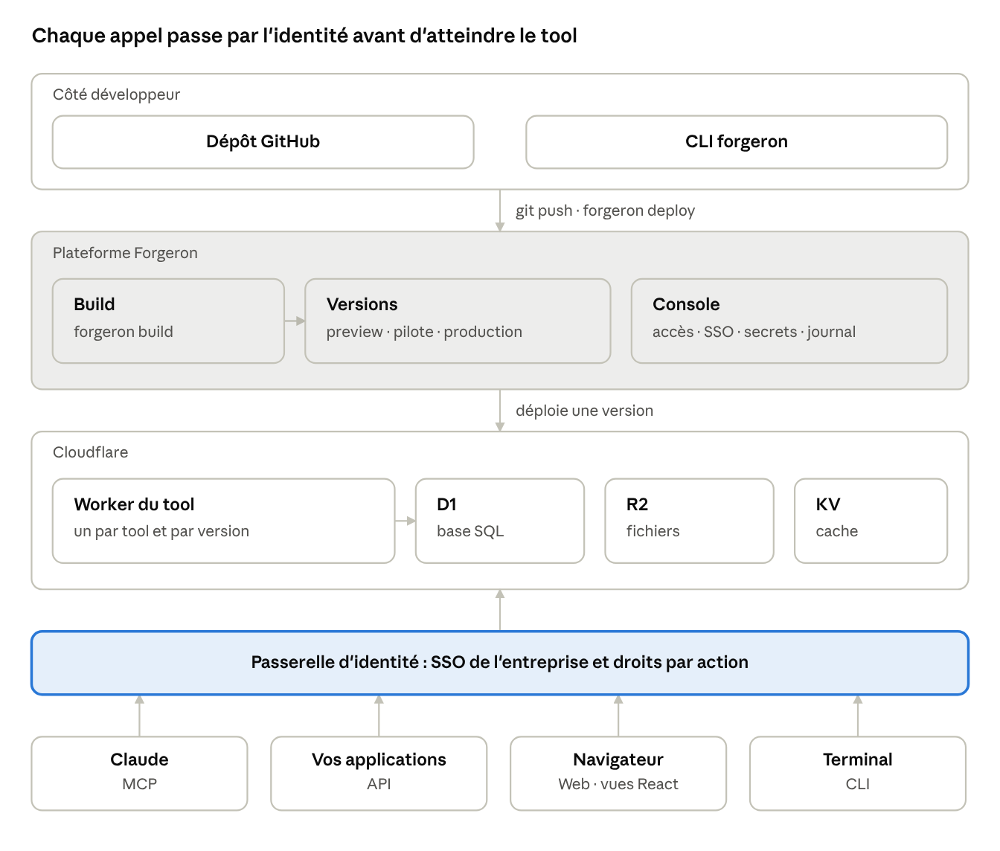
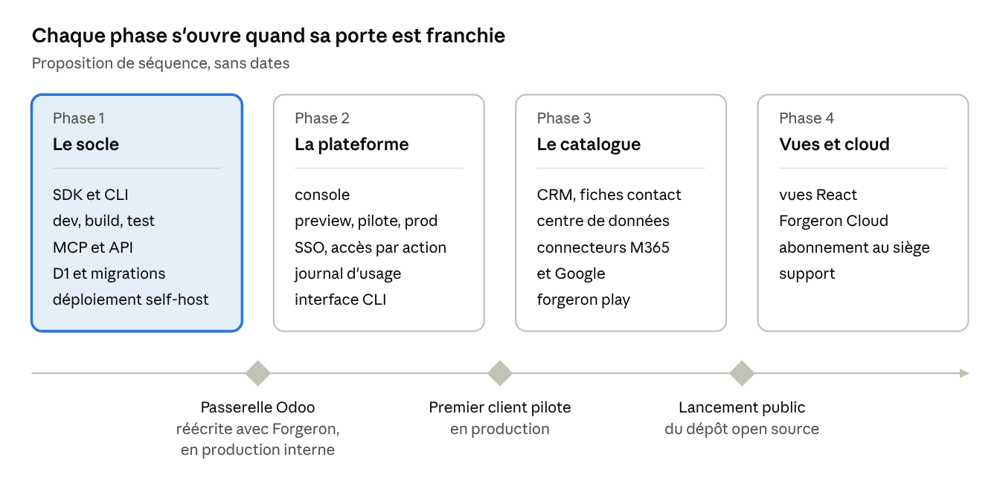

# Forgeron — White paper

20 octobre 2026 · Ely Delva · Version de travail

## Résumé

Forgeron est une plateforme open source pour écrire, versionner, héberger et gouverner les internal tools d'une entreprise. Un développeur décrit un outil une fois avec le SDK — ses données, ses actions, ses droits — et Forgeron l'expose automatiquement en quatre interfaces : **MCP** pour Claude, **API**, **Web** et **CLI**.

Le pari : demain, les équipes interagiront avec leurs outils métier d'abord à travers un assistant comme Claude. L'interface lourde d'un ERP perd alors sa valeur ; ce qui compte, ce sont des données fiables et des actions bien définies, avec les bons droits. Forgeron fournit exactement cette couche, en léger, sur Cloudflare Workers.

Trois choses à retenir :

- **Une manière d'écrire les tools, pas seulement un SDK.** Forgeron impose une forme légère et unique : un fichier de configuration, des tables, des actions, des vues. Tous les tools se ressemblent, donc tous se maintiennent.
- **Une plateforme de production.** Chaque push sur GitHub crée une version, déployée en preview, en pilote ou en production. Accès par rôle et par action, SSO d'entreprise, journal d'usage.
- **Des outils prêts à l'emploi.** Un catalogue de modèles légers (CRM, fiches contact, centre de données, passerelles d'API comme Odoo) que l'entreprise lance tels quels ou forge à sa mesure.

Forgeron se distribue en self-host (open source, sur le compte Cloudflare de l'entreprise) ou en cloud, avec un abonnement unique au siège.

## Le problème

Les entreprises paient des suites logicielles géantes pour une fraction de ce qu'elles utilisent, et leurs vrais outils internes vivent ailleurs, sans cadre.

**1. Les ERP coûtent cher pour ce qu'ils apportent.** Une suite comme Odoo se paie au module et à l'utilisateur. Elle impose son interface, son modèle de données et ses intégrations. Pour un besoin simple — suivre des contacts, des pistes, des demandes — l'entreprise achète un système entier.

**2. L'interface est en train de changer.** Les équipes commencent à travailler depuis Claude ou un autre assistant. Elles posent une question, demandent une action, et n'ouvrent plus l'application. À ce moment-là, peu importe qu'il y ait un ERP derrière : il faut seulement que les données et les actions répondent, de façon fiable et autorisée.

**3. Les internal tools faits maison ne sont pas industrialisés.** Chaque développeur interne écrit ses scripts, son petit serveur MCP, sa page d'admin, chacun à sa façon. Résultat :

- pas de versions ni d'environnement de test ;
- pas de gestion des accès cohérente, des clés d'API qui circulent ;
- aucune visibilité sur qui utilise quoi ;
- un outil qui meurt quand son auteur change de poste.

**4. Brancher un assistant IA sur les données de l'entreprise est encore artisanal.** L'exemple de la passerelle MCP Odoo construite en interne le montre : il faut une authentification SSO, un stockage des clés par personne, une passerelle vers l'API, un déploiement. C'est faisable, mais chaque équipe le réinvente.

Aucun de ces problèmes n'est technique au sens difficile. Ce qui manque, c'est une **manière standard** d'écrire, de déployer et de gouverner ces outils.

## La vision

Forgeron veut être **la dernière plateforme dont une entreprise a besoin pour ses internal tools** : l'endroit où on les forge, où ils tournent et où on décide qui y a accès.

Quatre convictions guident le produit :

1. **Le backend d'abord, l'interface ensuite.** Le cœur d'un tool, ce sont ses données et ses actions. Une fois définies, elles sont servies partout : à Claude par MCP, à d'autres logiciels par API, à un humain par le terminal ou une page web. Le premier livrable de Forgeron est donc un backend ; les vues viennent en complément.
2. **Claude est une interface souhaitable.** Parler à ses outils est plus rapide qu'apprendre un écran. Mais une conversation ne remplace pas tout : pour un pipeline commercial ou un tableau de bord, une vue légère en React, alimentée par les mêmes actions, garde sa place.
3. **Léger et modulaire plutôt qu'intégré et lourd.** Un CRM léger, une fiche contact légère, un centre de données léger : chaque outil fait une chose, se modifie sans risque et coûte peu à faire tourner.
4. **Une forme imposée, au service de la simplicité.** Forgeron ne laisse pas cent façons d'écrire un tool. Il en propose une, courte et lisible, que tous les développeurs de l'entreprise reconnaissent. C'est ce qui rend les outils maintenables, transmissibles et gouvernables.

Le nom porte l'idée : les développeurs internes viennent **forger** leurs propres outils à partir de bases, de modèles et de briques qui existent déjà, au lieu de dépendre d'une suite qui décide pour eux.

## Le produit

Forgeron se compose de six briques. Les trois premières sont open source et suffisent à faire tourner un tool ; les trois suivantes donnent la valeur d'usage.

| Brique                   | Ce que c'est                                                                                                                                                          | Pour qui                        |
| ------------------------ | --------------------------------------------------------------------------------------------------------------------------------------------------------------------- | ------------------------------- |
| **SDK** (`forgeron`)     | Bibliothèque TypeScript pour déclarer un tool : config, tables, migrations, actions, permissions, vues, connecteurs, tâches planifiées                                | Développeur                     |
| **CLI** (`forgeron …`)   | `init`, `dev`, `play`, `test`, `build`, `deploy`, `db`, `secrets`, `logs` — tout le cycle de vie depuis le terminal, et chaque action d'un tool appelable en commande | Développeur, utilisateur avancé |
| **Runtime**              | La couche qui exécute un tool sur Cloudflare Workers et sert ses quatre interfaces (MCP, API, Web, CLI)                                                               | —                               |
| **Console**              | Le tableau de bord de l'espace : tools, versions, environnements, accès par rôle et par action, SSO, secrets, journal d'usage                                         | Admin, responsable IT           |
| **Catalogue de modèles** | Des tools prêts à lancer : CRM léger, fiches contact, centre de données, passerelle d'API (ex. Odoo) — lancés tels quels ou forkés                                    | Toute l'entreprise              |
| **Connecteurs**          | Briques d'accès aux services courants (Microsoft 365, Google, Odoo, etc.) avec authentification déléguée                                                              | Développeur                     |

### Le terrain de jeu : `forgeron play`

Un espace pour essayer un tool sans écrire de client : la liste de ses actions, un formulaire généré pour chacune, le résultat, et l'aperçu de ce que Claude, l'API et le CLI en voient. En local, il s'ouvre avec `forgeron play` ; dans la console, il permet de découvrir les modèles du catalogue avant de les lancer.

### Ce que Forgeron ne réinvente pas

La règle : réutiliser l'existant chaque fois qu'il est bon, et ne construire que ce qui donne la forme Forgeron.

- **Réutilisé** : Cloudflare Workers et son écosystème (D1, R2, KV, Durable Objects), Kysely pour les requêtes SQL typées, Zod pour les schémas, Vitest pour les tests, React pour les vues, le protocole MCP.
- **Construit par Forgeron** : la structure d'un tool, le système de migrations, le build (`forgeron build`), la génération des quatre interfaces à partir d'une même action, le modèle de permissions, le versioning et les environnements.

## Comment ça marche

Un tool Forgeron est un dossier au format fixe ; une action déclarée une fois devient un outil MCP, une route d'API, une commande CLI et une donnée disponible pour les vues.

### L'anatomie d'un tool

```text
crm/
├── forgeron.config.ts      # nom, interfaces, rôles, connecteurs
├── db/
│   ├── schema.ts           # tables, en TypeScript
│   └── migrations/         # générées par forgeron db generate
├── actions/                # une action par fichier
├── views/                  # pages React (optionnel)
├── tests/                  # Vitest
└── .forgeron/              # lien vers l'espace (commité) + local (ignoré)
```

Le détail du SDK, avec des exemples complets (CRM, passerelle Odoo, fiches contact), est dans [`sdk.md`](sdk.md) et le dossier [`exemples/`](exemples/).

### Une action, quatre interfaces

| Interface | Ce que reçoit l'utilisateur                                          | Exemple pour `contacts.search`                     |
| --------- | -------------------------------------------------------------------- | -------------------------------------------------- |
| MCP       | Un outil que Claude peut appeler, décrit et typé                     | `crm_contacts_search`                              |
| API       | Une route HTTP authentifiée, avec schéma OpenAPI                     | `POST acme.forgeron.app/t/crm/api/contacts.search` |
| CLI       | Une commande, avec aide générée                                      | `forgeron crm contacts search "Durand"`            |
| Web       | Un hook pour les vues React, et un formulaire dans le terrain de jeu | `useAction("contacts.search")`                     |

La description, le schéma d'entrée et le niveau d'accès de l'action servent aux quatre. Un changement dans le code se propage partout à la version suivante.

### Le cycle de vie

1. **Développer** en local avec `forgeron dev` : le tool tourne comme en production, base de données comprise, avec son serveur MCP local.
2. **Pousser** sur GitHub : chaque push crée une version immuable, et chaque branche une preview.
3. **Ouvrir en pilote** une version à un groupe précis, pour la tester en conditions réelles.
4. **Promouvoir** en production depuis la console ou avec `forgeron deploy --env production`.
5. **Revenir en arrière** en un clic si besoin : la version précédente est toujours disponible.

### Les accès

Chaque personne se connecte par le SSO de l'entreprise. L'admin attribue des rôles ; chaque action déclare un niveau d'accès (lecture, écriture, suppression ou un niveau propre au tool) ; la console fait la correspondance rôle × action. Le même contrôle s'applique quelle que soit l'interface : demander à Claude ne donne pas plus de droits qu'appeler l'API.

## Architecture technique

Forgeron est une surcouche à Cloudflare Workers : la plateforme construit et versionne les tools, Cloudflare les exécute, et une passerelle d'identité contrôle chaque appel.



Les requêtes montent des interfaces vers le Worker ; le code descend du dépôt vers Cloudflare.

### Les choix techniques

| Couche                | Choix                                                                                              | Pourquoi                                                                    |
| --------------------- | -------------------------------------------------------------------------------------------------- | --------------------------------------------------------------------------- |
| Exécution             | Cloudflare Workers ; Workers for Platforms dans le cloud Forgeron, Workers classiques en self-host | Démarrage instantané, coût faible, isolation par tool                       |
| Base de données       | Cloudflare D1 (SQLite), interrogée avec Kysely                                                     | SQL typé sans ORM lourd ; une base par tool et par environnement            |
| Migrations            | Système propre à Forgeron, au-dessus de Kysely                                                     | Générées depuis le schéma, appliquées à chaque déploiement, réversibles     |
| Fichiers, cache, état | R2, KV, Durable Objects                                                                            | Les briques natives de Cloudflare, exposées par le SDK                      |
| Schémas               | Zod                                                                                                | Un seul schéma pour valider, typer et générer MCP, OpenAPI et l'aide du CLI |
| Build                 | `forgeron build`, propre à Forgeron (moteur de bundling existant en dessous)                       | Une sortie unique : le Worker, le manifeste des actions, les vues           |
| Tests                 | Vitest, avec un contexte de test fourni par le SDK                                                 | Ne pas réinventer ; base locale en mémoire                                  |
| Dev local             | `forgeron dev`, sur le runtime local de Cloudflare                                                 | Le même comportement qu'en production                                       |
| Vues                  | React, avec des hooks du SDK                                                                       | Les données arrivent avec les droits de la personne connectée               |

## Sécurité et gouvernance

Un internal tool manipule les données de l'entreprise : Forgeron fait de la sécurité une propriété de la forme, pas une option laissée à chaque développeur.

- **Identité unique.** Connexion par le SSO de l'entreprise (Microsoft Entra ID, Google Workspace, SAML/OIDC) pour la console, les vues, l'API et le serveur MCP. Le CLI s'authentifie par `forgeron login`, via le navigateur.
- **Permissions déclaratives.** Chaque action porte son niveau d'accès dans le code ; aucune action n'est exposée sans. La console règle la correspondance rôles × actions, sans redéployer.
- **Secrets séparés du code.** Deux niveaux : les secrets du tool (`forgeron secrets set`), chiffrés côté plateforme, et les secrets par personne — par exemple la clé d'API Odoo de chaque collaborateur, saisie une fois à la connexion et jamais visible du développeur.
- **Isolation.** Chaque tool et chaque version tournent dans leur propre Worker, avec leur propre base. Une preview n'a jamais accès aux données de production, sauf choix explicite.
- **Journal d'usage.** Chaque appel d'action est tracé : qui, quand, par quelle interface (Claude, API, Web, CLI), avec quel résultat. L'admin voit qui utilise quel tool et peut révoquer un accès immédiatement.
- **Pas de sécurité par le prompt.** Ce que Claude peut faire est borné par les droits de la personne connectée, côté serveur. Une instruction glissée dans une conversation ne peut pas élargir ces droits.
- **Souveraineté.** En self-host, tout tourne sur le compte Cloudflare de l'entreprise : Forgeron n'a pas accès aux données.

## À qui on s'adresse

La cible première : les entreprises qui ont au moins un développeur en interne, utilisent déjà un assistant IA et trouvent leur ERP trop lourd pour leurs besoins.

### Les segments

| Segment                                | Leur situation                                               | Ce que Forgeron leur apporte                                           |
| -------------------------------------- | ------------------------------------------------------------ | ---------------------------------------------------------------------- |
| PME et ETI avec une petite équipe tech | Un ERP coûteux, des besoins simples, un ou deux développeurs | Remplacer des modules par des tools légers, utilisables depuis Claude  |
| Équipes IT et DSI                      | Des scripts et serveurs MCP faits maison, sans gouvernance   | Un cadre unique : versions, accès, SSO, journal                        |
| Agences et intégrateurs                | Des outils sur mesure livrés à plusieurs clients             | Une base commune, déployable chez chaque client, en self-host ou cloud |
| Startups et équipes produit            | Un back-office à construire vite                             | Des modèles prêts à forker et une stack complète dès le premier jour   |

### Les personas

- **Le développeur interne** forge et maintient les tools. Il veut une stack simple, un CLI qui fait tout, des tests et un déploiement en une commande.
- **L'admin ou le responsable IT** gouverne. Il veut savoir qui accède à quoi, brancher le SSO une fois, révoquer un accès en un clic.
- **L'utilisateur métier** — commercial, support, direction — ne voit pas Forgeron. Il parle à Claude, ouvre une vue, et ses outils répondent.
- **Le décideur** — dirigeant, DAF — compare le coût d'un ERP au coût d'un abonnement unique et d'outils qui font exactement ce qu'il faut.

## Modèle économique et open source

Forgeron est open source pour gagner la confiance des développeurs, et se rémunère sur l'hébergement et la gouvernance, avec un seul plan au siège.

|                   | Self-host                                         | Forgeron Cloud                                                                         |
| ----------------- | ------------------------------------------------- | -------------------------------------------------------------------------------------- |
| Ce qui est inclus | SDK, CLI, runtime, modèles                        | Tout le self-host, plus la console hébergée, le SSO, les connecteurs gérés, le support |
| Où ça tourne      | Le compte Cloudflare de l'entreprise              | Notre infrastructure, sur Cloudflare                                                   |
| Coût              | Gratuit ; l'entreprise paie Cloudflare            | Un abonnement unique par siège et par mois : [PRIX À FIXER]                            |
| Pour qui          | Équipes tech autonomes, exigences de souveraineté | Entreprises qui veulent que ça marche, sans opérer                                     |

Pourquoi un plan unique : la promesse est l'inverse de l'ERP au module. Un siège donne accès à tous les tools de l'espace, à tous les modèles et à toutes les interfaces. L'équipe a évoqué une piste autour de 20 € par personne et par mois ; elle reste à valider face aux coûts d'infrastructure et au marché.

Revenus complémentaires possibles, à étudier : accompagnement à la création de tools sur mesure, modèles premium, support étendu pour le self-host.

**Licence** : à choisir. Une licence permissive (MIT, Apache 2.0) maximise l'adoption ; une licence de type AGPL ou source-available protège le cloud contre la revente par un tiers.

## Positionnement

Forgeron se place entre l'ERP qu'on achète et le code qu'on écrit seul : du code, mais dans un cadre de production, pensé pour être utilisé depuis Claude.

| Alternative                            | Ce qu'elle fait bien                   | Ce qui manque, et que Forgeron apporte                                             |
| -------------------------------------- | -------------------------------------- | ---------------------------------------------------------------------------------- |
| ERP et suites métier                   | Couverture fonctionnelle large         | Légèreté, coût, interface libre, accès natif depuis Claude                         |
| Plateformes low-code d'outils internes | Construire vite des écrans             | Un backend d'abord, du vrai code versionné, MCP et CLI natifs, open source         |
| Serveurs MCP faits maison              | Brancher vite un assistant sur une API | Versions, accès, SSO, secrets par personne, journal, déploiement                   |
| Un Worker Cloudflare écrit à la main   | Performance et coût                    | Une forme standard, la base, les migrations, les quatre interfaces, la gouvernance |

Ce qui rend Forgeron défendable : la **forme imposée**. Plus une entreprise a de tools écrits de la même façon, plus le catalogue, les connecteurs et la console prennent de la valeur, et plus il devient simple d'en écrire un de plus.

## Feuille de route proposée

On commence par le socle développeur et on le prouve sur un cas réel, la passerelle MCP Odoo déjà construite en interne, avant d'ouvrir la plateforme à des clients.



Les dates restent à fixer ; chaque phase ne commence qu'une fois la porte précédente franchie.

## Questions ouvertes

- [ ] Licence open source : permissive ou protectrice du cloud ?
- [ ] Prix du siège, et seuil éventuel (nombre minimal de sièges, offre gratuite pour une petite équipe) ?
- [x] Exécution : Workers for Platforms dans le cloud, Workers classiques en self-host, derrière une même interface (décidé le 22/10/2026, `DECISIONS.md` D-009).
- [ ] Base de données : D1 par tool et par environnement est retenu (`DECISIONS.md` D-010) ; reste la question : D1 seul, ou option Postgres (via Hyperdrive) pour les entreprises qui en ont déjà un ?
- [ ] Vues : rendu côté serveur ou application React servie statiquement ?
- [ ] Quels connecteurs en premier : Microsoft 365, Google Workspace, Odoo ?
- [ ] Quels modèles dans le catalogue de lancement, et qui les maintient ?
- [ ] Nom de domaine, organisation GitHub et nom du paquet npm `forgeron` : disponibles ?
